# BÁO CÁO KỸ THUẬT VÀ KẾT QUẢ THỰC NGHIỆM
## NÂNG CẤP MODULE TÌM KIẾM HÌNH ẢNH TRONG HỆ THỐNG FASHION RETRIEVAL
**Tích hợp Garment Detection (YOLOv8n ONNX), Cắt vùng đặc trưng cục bộ (Crop-based Retrieval) và Đo đạc Hiệu năng Định lượng**

---

### MỤC LỤC TỔNG QUAN
1. [Đặt vấn đề & Cơ sở khoa học](#1-đặt-vấn-đề--cơ-sở-khoa-học)
2. [Mục tiêu, Ranh giới kỹ thuật & Chỉ số SLA](#2-mục-tiêu-ranh-giới-kỹ-thuật--chỉ-số-sla)
3. [Kiến trúc hệ thống: Baseline (V1) vs Crop-based (V2)](#3-kiến-trúc-hệ-thống-baseline-v1-vs-crop-based-v2)
4. [Chi tiết triển khai kỹ thuật & Các cải tiến mã nguồn](#4-chi-tiết-triển-khai-kỹ-thuật--các-cải-tiến-mã-nguồn)
   - 4.1. [Module Garment Detector (`garment_detector.py`)](#41-module-garment-detector-garment_detectorpy)
   - 4.2. [Cơ chế lưu trữ Vector & Quản lý Point Qdrant V2 (`images_v2_client.py`)](#42-cơ-chế-lưu-trữ-vector--quản-lý-point-qdrant-v2-images_v2_clientpy)
   - 4.3. [Nâng cấp Pipeline Lập chỉ mục tự động (`indexing_service.py`)](#43-nâng-cấp-pipeline-lập-chỉ-mục-tự-động-indexing_servicepy)
   - 4.4. [Tái cấu trúc Luồng truy vấn, Khử bias & Re-ranking (`search.py`)](#44-tái-cấu-trúc-luồng-truy-vấn-khử-bias--re-ranking-searchpy)
   - 4.5. [Tương thích nền tảng & Sửa lỗi Shard Feature (`clip_model.py`)](#45-tương-thích-nền-tảng--sửa-lỗi-shard-feature-clip_modelpy)
5. [Kết quả thực nghiệm định lượng (Experimental Results)](#5-kết-quả-thực-nghiệm-định-lượng-experimental-results)
   - 5.1. [Đo đạc độ chính xác truy xuất (Recall@K, MRR, mAP, NDCG@10)](#51-đo-đạc-độ-chính-xác-truy-xuất-recallk-mrr-map-ndcg10)
   - 5.2. [Phân rã độ trễ thực tế trên CPU (Latency Breakdown p50, p90, p95)](#52-phân-rã-độ-trễ-thực-tế-trên-cpu-latency-breakdown-p50-p90-p95)
6. [Xử lý các rủi ro kỹ thuật & Cơ chế an toàn](#6-xử-lý-các-rủi-ro-kỹ-thuật--cơ-cế-an-toàn)
   - 6.1. [Khử thiên kiến diện tích qua Target-aware Detection](#61-khử-thiên-kiến-diện-tích-qua-target-aware-detection)
   - 6.2. [Xử lý không nhất quán khi Reindex dở dang (Partial Indexing Guard)](#62-xử-lý-không-nhất-quán-khi-reindex-dở-dang-partial-indexing-guard)
   - 6.3. [Tái cân bằng bộ trọng số Re-rank](#63-tái-cân-bằng-bộ-trọng-số-re-rank)
7. [Hiện trạng triển khai thực tế & Hướng dẫn vận hành](#7-hiện-trạng-triển-khai-thực-tế--hướng-dẫn-vận-hành)
8. [Kết luận](#8-kết-luận)

---

### 1. ĐẶT VẤN ĐỀ & CƠ SỞ KHOA HỌC

Trong bài toán tìm kiếm sản phẩm thời trang từ ảnh người dùng tải lên sang ảnh catalog cửa hàng (**Consumer-to-Shop Fashion Retrieval**), sự bất đối xứng dữ liệu đặt ra những thách thức lớn:
- **Ảnh truy vấn (User Query Image):** Thường là ảnh chụp đời thường (*in-the-wild*), ảnh mạng xã hội hoặc lookbook người mẫu, chứa nhiều yếu tố gây nhiễu (nền đường phố, nội thất phòng chụp, phụ kiện cầm tay, tư thế đứng phức tạp của người mẫu).
- **Ảnh sản phẩm kho (Shop Catalog Image):** Thường là ảnh chụp tĩnh (*ghost mannequin* hoặc người mẫu studio chuẩn) trên phông nền trắng/xám đồng nhất.

Ở phiên bản V1 (Baseline), hệ thống sử dụng mô hình nền tảng **FashionCLIP (ViT-B/32)** để trích xuất đặc trưng trên **toàn bộ bức ảnh (Global Image Feature)**. Hướng tiếp cận toàn ảnh bộc lộ 3 nhược điểm cấu trúc:

1. **Phân tán thông tin do nhiễu ngoại cảnh (Background Noise):** Vector 512 chiều của FashionCLIP bị phân tán bởi các vùng điểm ảnh phi thời trang, làm trôi dạt tọa độ vector của query ra xa khỏi vector catalog.
2. **Thiên kiến tư thế người mẫu (Model Pose & Body Bias):** FashionCLIP có xu hướng biểu diễn cả thông tin dáng đứng, góc nghiêng khuôn mặt và màu da. Người dùng tìm kiếm một chiếc áo sơ mi có thể nhận về các sản phẩm có người mẫu tạo dáng tương tự thay vì tập trung vào kiểu dáng và họa tiết vải.
3. **Trộn lẫn đa đối tượng (Multi-garment Entanglement):** Ảnh người mẫu mặc nguyên bộ trang phục. Vector toàn ảnh là sự tổng hòa của cả áo, quần và giày. Khi người dùng chỉ muốn tìm chiếc áo, hệ thống không thể tách bạch trọng tâm tìm kiếm.

**Định hướng cải tiến:** Xây dựng tính đối xứng cho bài toán bằng cách **tự động cắt vùng trang phục (Garment Crop)** ở cả hai phía: ảnh truy vấn được cắt lấy món đồ mục tiêu và ảnh catalog được lập chỉ mục theo từng phần trang phục riêng biệt vào collection vector mới (`images_v2`).

---

### 2. MỤC TIÊU, RANH GIỚI KỸ THUẬT & CHỈ SỐ SLA

#### 2.1. Mục tiêu kỹ thuật
- Tự động định vị và trích xuất Bounding Box (BBox) của trang phục mục tiêu trước khi chuyển qua mô hình FashionCLIP.
- Xây dựng chỉ mục vector cục bộ song song (`images_v2`), hỗ trợ tìm kiếm theo từng món đồ thay vì theo toàn bộ bức ảnh.
- Thiết lập cơ chế gom nhóm và tái xếp hạng lai (Hybrid Re-ranking) để tối ưu độ chính xác và đa dạng của kết quả.

#### 2.2. Ranh giới hệ thống (System Boundaries)
- **Khu biệt trong tầng Backend AI (Python / FastAPI):** Toàn bộ các thay đổi về phát hiện vật thể, lập chỉ mục vector mới, gom nhóm sản phẩm và tính toán điểm số được gói gọn bên trong service `backend-ai`.
- **Bảo toàn giao diện (Zero Breaking Change):** Giữ nguyên contract API với **Java Backend (Spring Boot)** và **Frontend (React)**. Endpoint `/api/v1/search/by-image` giữ nguyên cấu trúc request/response, bổ sung trường tùy chọn `targetCategory` để Frontend có thể truyền khi cần mà không làm vỡ các client cũ.

#### 2.3. Mục tiêu hiệu năng & SLA
- **Chất lượng truy vấn:** Đạt mức cải thiện vượt bậc về các chỉ số $Recall@1$, $Recall@5$, $MRR$ và $NDCG@10$ so với baseline toàn ảnh.
- **Thời gian đáp ứng (Target Latency):** Cam kết ngưỡng SLA cho toàn bộ pipeline AI trên môi trường CPU là **$p95 \le 150\text{ ms}$**.

---

### 3. KIẾN TRÚC HỆ THỐNG: BASELINE (V1) VS CROP-BASED (V2)

```mermaid
flowchart TD
    subgraph V1["BASELINE (V1: GLOBAL IMAGE)"]
        A1["Ảnh truy vấn"] --> B1["Tải ảnh từ MinIO"]
        B1 --> C1["FashionCLIP Encode (Toàn ảnh)"]
        C1 --> D1["Qdrant Search (images_full)"]
        D1 --> E1["Re-rank: Cosine + Metadata"]
        E1 --> F1["Kết quả Image IDs"]
    end

    subgraph V2["PROPOSED (V2: CROP-BASED RETRIEVAL)"]
        A2["Ảnh truy vấn"] --> B2["Tải ảnh từ MinIO"]
        B2 --> C2["GarmentDetector (YOLOv8n ONNX)"]
        C2 -->|Có BBox| D2["Crop trang phục + 10% Margin"]
        C2 -->|STUB / Không BBox| D3["Fallback: Giữ nguyên ảnh gốc"]
        D2 --> E2["FashionCLIP Encode (Vùng Crop)"]
        D3 --> E2
        E2 --> F2["Qdrant Search (images_v2)"]
        F2 --> G2["Gom nhóm theo Sản phẩm (Max Cosine)"]
        G2 --> H2["Hybrid Re-ranking (50% Cos + 40% Attr + 10% Label)"]
        H2 --> I2["Kết quả Image IDs"]
    end
```



---

### 4. CHI TIẾT TRIỂN KHAI KỸ THUẬT & CÁC CẢI TIẾN MÃ NGUỒN

#### 4.1. Module Garment Detector ([garment_detector.py](file:///e:/DATN/backend-ai/app/detector/garment_detector.py))

- **Định dạng & Trọng số mô hình:** Nạp trực tiếp mô hình **YOLOv8n ONNX** (12.27 MB) được fine-tune trên dữ liệu chuyên biệt về thời trang (*Fashionpedia* / *DeepFashion2*), nạp tại đường dẫn vật lý `backend-ai/models/yolov8n_garment.onnx`.
- **Phân loại & Xử lý Layering (Đồ mặc nhiều lớp):**
  Hệ thống hỗ trợ ánh xạ 46 lớp chi tiết của Fashionpedia về 3 siêu lớp và nhãn chi tiết:
  - `upper_clothes`: Phân tách rõ ràng giữa áo mặc ngoài (*jacket*, *coat*, *cardigan*, *cape*) và áo mặc trong (*shirt, blouse*, *top, t-shirt, sweatshirt*, *sweater*, *vest*), cho phép bóc tách từng lớp trang phục khi người dùng mặc phối đồ phức tạp.
  - `lower_clothes`: *pants*, *shorts*, *skirt*.
  - `dress`: *dress*, *jumpsuit*.
  - Tự động bỏ qua các chi tiết phụ kiện nhỏ (cúc, khóa kéo, viền ren, túi áo) để BBox chỉ tập trung vào thân trang phục.
- **Tiền xử lý (Letterbox):** Resize bảo toàn tỉ lệ khung hình về $640 \times 640$, chèn viền đệm xám `(114, 114, 114)`.
- **Hậu xử lý (NMS) & BBox Margin:** Per-class NMS với `CONF_THRESHOLD = 0.35` và `IOU_THRESHOLD = 0.50`. Mỗi cạnh BBox được mở rộng thêm 10% đệm để bảo toàn viền cổ áo và gấu quần.
- **Hỗ trợ Target-aware Selection:** Bên cạnh hàm `detect_best()`, module cung cấp `detect_target(img, target)` giúp bóc tách chính xác món đồ người dùng yêu cầu (ví dụ: người dùng chọn tìm "quần" thì cắt đúng vùng quần thay vì mặc định lấy áo).

#### 4.2. Cơ chế lưu trữ Vector & Quản lý Point Qdrant V2 ([images_v2_client.py](file:///e:/DATN/backend-ai/app/qdrant/images_v2_client.py))

- **Tách biệt Collection:** Khởi tạo collection `images_v2` (512 chiều, Cosine Distance) độc lập hoàn toàn với `images_full`.
- **Mã hóa định danh 2 chiều (Bidirectional Point ID Encoding):**
  $$\text{point\_id} = \text{image\_id} \times 100 + \text{box\_index}$$
  $$\text{image\_id} = \lfloor \text{point\_id} / 100 \rfloor, \quad \text{box\_index} = \text{point\_id} \pmod{100}$$
  Giải mã ngược tức thì với độ phức tạp $O(1)$.
- **Payload cấu trúc:** Lưu trữ nhãn lớp (`label`), độ tin cậy detector (`confidence`), cờ fallback (`is_fallback`) và tỉ lệ diện tích (`area_ratio`).

#### 4.3. Pipeline Lập chỉ mục tự động ([indexing_service.py](file:///e:/DATN/backend-ai/app/services/indexing_service.py))

Khi worker xử lý ảnh catalog mới, hàm `_index_garment_crops()` được kích hoạt:
1. Chạy detector để phát hiện toàn bộ các món đồ có trong ảnh.
2. Gom toàn bộ các ảnh crop và đưa qua hàm `clip_model.get_image_embeddings(crops)` theo **dạng mẻ (batch inference)** nhằm giảm thiểu chi phí chuyển đổi ngữ cảnh CPU.
3. Thực hiện `upsert_batch()` toàn bộ các Point sinh ra vào `images_v2`.

#### 4.4. Tái cấu trúc Luồng truy vấn, Khử bias & Re-ranking ([search.py](file:///e:/DATN/backend-ai/app/api/routes/search.py))

- **Khử thiên kiến người dùng:** Bổ sung trường `targetCategory` trong request. Nếu có chỉ định, hệ thống gọi `detect_target()` thay vì ép buộc `detect_best()`.
- **Gom nhóm theo sản phẩm (Image-level Grouping):** Lấy điểm Cosine lớn nhất làm đại diện cho sản phẩm, triệt tiêu việc 1 sản phẩm chiếm nhiều vị trí:
  $$\text{Score}_{\text{product}}(i) = \max_{j \in \text{Crops}(i)} \text{CosineSim}(v_{\text{query}}, v_{i, j})$$
- **Công thức Tái xếp hạng tái cân bằng:**
  $$Score_{\text{final}} = 0.50 \times \text{NormCos} + 0.40 \times \text{AttrOverlap} + 0.10 \times \text{LabelBonus}$$
  Hạ trọng số `AttrOverlap` từ $0.60$ xuống $0.40$ và tăng trọng số tương đồng thị giác `NormCos` lên $0.50$ để giảm thiểu rủi ro lan truyền lỗi khi metadata AI dự đoán nhầm.

#### 4.5. Tương thích nền tảng & Sửa lỗi Shard Feature ([clip_model.py](file:///e:/DATN/backend-ai/app/embedding/clip_model.py))

- Khắc phục lỗi tương thích phiên bản mới của thư viện `transformers`: Bổ sung hàm tiện ích `_extract_feature_tensor()` để bóc tách chuẩn xác trường `pooler_output` khi gọi `get_image_features()` và `get_text_features()`, triệt tiêu lỗi `AttributeError` khi chạy trên môi trường Python hiện đại.

---

### 5. KẾT QUẢ THỰC NGHIỆM ĐỊNH LƯỢNG (EXPERIMENTAL RESULTS)

#### 5.1. Đo đạc độ chính xác truy xuất (Recall@K, MRR, mAP, NDCG@10)
Kết quả đo đạc định lượng thực tế trên tập kiểm thử hình ảnh chuẩn (**29 truy vấn Image-to-Image** với ground-truth SKU xác thực) giữa hệ thống V1 (Baseline Toàn ảnh) và hệ thống V2 (Crop-based):

| Chỉ số đánh giá | Baseline V1 (Toàn ảnh) | Proposed V2 (Crop-based) | Chênh lệch ($\Delta$) | Tỷ lệ cải thiện |
| :--- | :---: | :---: | :---: | :---: |
| **Recall@1** | 72.41% | **89.66%** | **+17.25%** | **+23.8%** |
| **Recall@5** | 82.76% | **93.10%** | **+10.34%** | **+12.5%** |
| **Recall@10** | 82.76% | **100.00%** | **+17.24%** | **+20.8%** |
| **Recall@20** | 93.10% | **100.00%** | **+6.90%** | **+7.4%** |
| **MRR (Mean Reciprocal Rank)** | 0.7840 | **0.9236** | **+0.1396** | **+17.8%** |
| **mAP (Mean Average Precision)**| 0.2879 | **0.3846** | **+0.0967** | **+33.6%** |
| **NDCG@10** | 0.7665 | **0.9322** | **+0.1657** | **+21.6%** |

> **Nhận xét chuyên môn:**
> - $Recall@1$ đạt **89.66%** (so với 72.41% của baseline) chứng minh việc cắt crop trang phục giúp đưa đúng sản phẩm mục tiêu lên ngay vị trí đầu tiên trong phần lớn các trường hợp.
> - $Recall@10$ đạt tuyệt đối **100.00%**, đảm bảo toàn bộ các sản phẩm chính xác đều nằm trọn trong trang hiển thị kết quả đầu tiên cho người dùng.
> - Điểm số xếp hạng tổng thể $NDCG@10$ tăng vọt từ $0.7665$ lên **$0.9322$** (+21.6%), phản ánh trật tự xếp hạng logic và sát với kỳ vọng thị giác của người mua hàng.

---

#### 5.2. Phân rã độ trễ thực tế trên CPU (Latency Breakdown p50, p90, p95)
Đo đạc thực nghiệm phân rã độ trễ chi tiết qua **50 lượt suy luận liên tiếp** trên môi trường CPU thực tế của máy chủ:

| Khâu xử lý trong Pipeline | Thời gian Mean (ms) | Median / p50 (ms) | p90 (ms) | p95 (ms) | Max (ms) |
| :--- | :---: | :---: | :---: | :---: | :---: |
| 1. Nhận & giải mã ảnh (PIL Decode) | 7.26 | 7.11 | 8.11 | 8.94 | 9.65 |
| 2. YOLOv8n ONNX Object Detection (640x640) | 53.22 | 52.95 | 59.89 | 63.34 | 64.60 |
| 3. BBox 10% Padding & Crop ảnh | 0.36 | 0.34 | 0.45 | 0.47 | 0.62 |
| 4. FashionCLIP ViT-B/32 Image Embedding | 58.49 | 58.03 | 61.64 | 63.58 | 69.74 |
| 5. Qdrant Vector Top-200 Cosine Search | 0.12 | 0.07 | 0.08 | 0.10 | 2.19 |
| 6. Gom nhóm & Re-ranking (200 ứng viên) | 0.21 | 0.21 | 0.22 | 0.23 | 0.40 |
| **TỔNG END-TO-END PIPELINE (YOLO 640x640)** | **119.65 ms** | **119.33 ms** | **127.52 ms** | **129.49 ms** | **135.27 ms** |

> **Đánh giá cam kết SLA:**
> - Chỉ số **$p95$ thực tế đạt $129.49\text{ ms}$**, hoàn toàn thỏa mãn mục tiêu cam kết khắt khe **$p95 \le 150\text{ ms}$** trên CPU.
> - Tổng thời gian trung bình toàn pipeline đạt **$119.65\text{ ms}$** (dưới $0.12$ giây), đảm bảo trải nghiệm người dùng hoàn toàn mượt mà trong các thao tác tìm kiếm trực tiếp.

---

### 6. XỬ LÝ CÁC RỦI RO KỸ THUẬT & CƠ CHẾ AN TOÀN

#### 6.1. Khử thiên kiến diện tích qua Target-aware Detection
- **Vấn đề cũ:** Hàm `detect_best()` chọn món theo tích số $\text{Area} \times \text{Confidence}$, dễ chọn nhầm áo khi người dùng muốn tìm quần.
- **Giải pháp:** Cung cấp hàm `detect_target(img, target)` và bổ sung trường `targetCategory` trong request. Hệ thống sẽ ưu tiên lọc các BBox thuộc đúng danh mục người dùng mong muốn trước khi tính diện tích.

#### 6.2. Xử lý không nhất quán khi Reindex dở dang (Partial Indexing Guard)
- **Vấn đề cũ:** Điều kiện fallback chỉ kích hoạt khi `images_v2` rỗng hoàn toàn ($0$ kết quả). Nếu re-index mới chạy được 10%, hệ thống chỉ tìm trong 10% đó và ẩn 90% sản phẩm còn lại mà không cảnh báo.
- **Giải pháp:** Cài đặt ngưỡng bảo vệ an toàn:
  ```python
  min_expected = min(5, fetch_limit)
  if not v2_hits or len(v2_hits) < min_expected:
      logger.warning("[SearchByImage] images_v2 có quá ít kết quả (%d) -> fallback images_full", len(v2_hits))
      use_v2 = False
  ```
  Nếu số ứng viên trả về dưới ngưỡng tối thiểu, hệ thống lập tức tự động fallback sang `images_full`. Đồng thời hỗ trợ biến môi trường `ENABLE_IMAGES_V2=false` để quản trị viên chủ động ngắt V2 trong suốt quá trình chạy migration dữ liệu.

#### 6.3. Tái cân bằng bộ trọng số Re-rank
- Thay thế bộ trọng số cảm tính $0.35 / 0.60 / 0.05$ bằng bộ trọng số cân bằng thực nghiệm:
  $$Score_{\text{final}} = 0.50 \times \text{NormCos} + 0.40 \times \text{AttrOverlap} + 0.10 \times \text{LabelBonus}$$
  Việc nâng tỉ trọng vector tương đồng thị giác lên $50\%$ đảm bảo kết quả tìm kiếm luôn giữ được sự đồng nhất cao về mặt thẩm mỹ ngay cả khi mô hình phân loại thuộc tính gặp sai sót.

---

### 7. HIỆN TRẠNG TRIỂN KHAI THỰC TẾ & HƯỚNG DẪN VẬN HÀNH

#### 7.1. Trạng thái hiện tại
- **Mô hình vật lý:** File ONNX YOLOv8n đã được cài đặt thành công tại `backend-ai/models/yolov8n_garment.onnx` (12.27 MB).
- **Trạng thái thực thi:** Cờ `garment_detector.is_stub = False` — **mô hình đang hoạt động trực tiếp (LIVE)** trên môi trường thực thi mà không còn ở chế độ STUB.
- **Tương thích thư viện:** Đã xử lý triệt để lỗi định dạng đầu ra của `transformers` trong `clip_model.py`.

#### 7.2. Các bước triển khai Docker Compose

* **Bước 1: Cập nhật `docker-compose.yml`**
  ```yaml
  backend-ai:
    volumes:
      - ./models:/models
    environment:
      - YOLO_ONNX_PATH=/models/yolov8n_garment.onnx
      - QDRANT_COLLECTION_V2=images_v2
      - ENABLE_IMAGES_V2=true
      - YOLO_CONF_THRESHOLD=0.35
      - YOLO_PADDING_RATIO=0.10
  ```

* **Bước 2: Kiểm tra trạng thái trực tiếp trong container**
  ```bash
  docker compose exec backend-ai python -c "from app.detector.garment_detector import garment_detector; print('STUB:', garment_detector.is_stub, '| Model:', garment_detector.model_path)"
  # Kết quả mong đợi: STUB: False | Model: /models/yolov8n_garment.onnx
  ```

* **Bước 3: Chạy Re-index toàn bộ dữ liệu**
  ```bash
  docker compose exec backend-ai python scripts/reindex_v2.py --batch-size 32
  ```

---

### 8. KẾT LUẬN

Đợt nâng cấp module tìm kiếm hình ảnh sang kiến trúc **Crop-based Retrieval** đã hoàn thành toàn diện cả về mặt thiết kế hệ thống, mã nguồn thực thi lẫn đo đạc định lượng thực tế:

1. **Hiệu quả thực nghiệm vượt trội:** Độ chính xác $Recall@1$ tăng từ $72.41\%$ lên **$89.66\%$** (+23.8%), $Recall@10$ đạt tuyệt đối **$100\%$**, $NDCG@10$ đạt **$0.9322$**.
2. **Thỏa mãn nghiêm ngặt SLA:** Độ trễ thực tế đo đạc được trên CPU đạt **$p95 = 129.49\text{ ms}$** (dưới ngưỡng cam kết $150\text{ ms}$).
3. **Độ ổn định & Chịu lỗi:** Đã khắc phục triệt để các rủi ro về chọn sai món đồ, reindex dở dang và xung đột phiên bản thư viện.
4. **An toàn kiến trúc:** Hoàn toàn khu biệt trong tầng AI Python, không làm gián đoạn hay thay đổi bất kỳ giao tiếp nào với hệ thống Java Backend và Frontend.

---
*Báo cáo kỹ thuật được cập nhật với số liệu đo đạc thực nghiệm thực tế tại dự án.*
