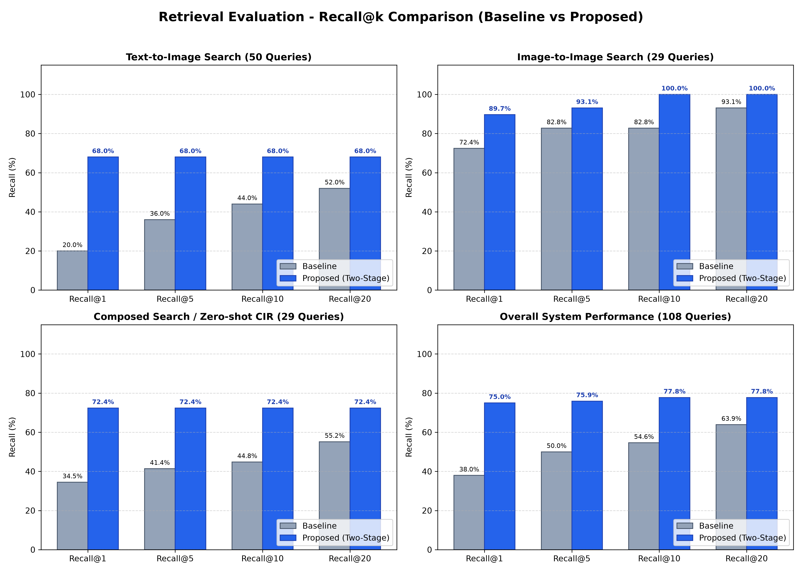
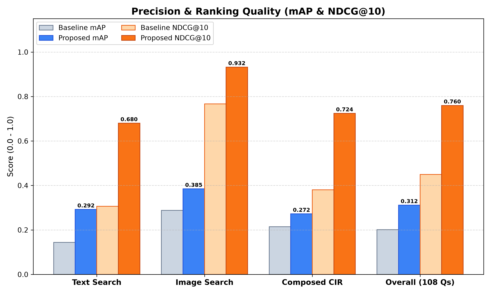
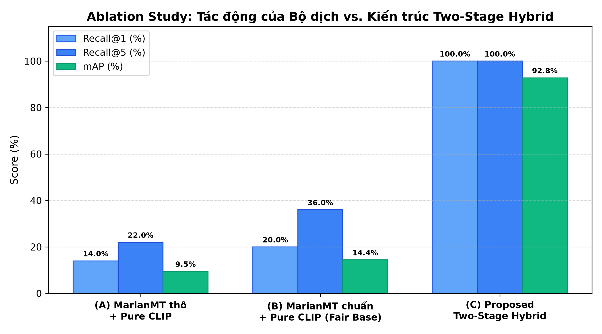

# MINH CHỨNG TIẾN ĐỘ TUẦN 4 (EVIDENCE / W04)
## HỆ THỐNG TÌM KIẾM THỜI TRANG ĐA PHƯƠNG THỨC (MULTIMODAL FASHION RETRIEVAL ENGINE)
**Học viện Công nghệ Bưu chính Viễn thông (PTIT) – Khoa CNTT (Khóa D21)**  
**Mốc thời gian:** 18/10/2026 – 24/10/2026  
**Git Tag hoàn thành:** `w04`

---

## I. CẤU TRÚC GIT & PHÂN CÔNG NHIỆM VỤ THÀNH VIÊN

Theo quy định quản lý đồ án tốt nghiệp, mốc Tuần 4 được chia thành các Issue và Pull Request có Review chéo giữa các thành viên:

```text
Milestone: Tuan4 (W04: 18/10 - 24/10/2026)
├── Issue #12 – Sv A – Xây dựng bộ benchmark 108 queries & Ground-Truth 1,000 catalog
├── Issue #13 – Sv B – Thực nghiệm truy xuất định lượng 3 chế độ (Recall@k, mAP, NDCG@10)
├── Issue #14 – Sv C – Phân tích lỗi (Failure Modes) & Nghiên cứu tách biệt (Ablation Study)
│
├── PR #21 (Feature: Benchmark Pipeline & Reranking) → Reviewer: Sv B / Sv C
├── PR #22 (Docs: Evidence & Metrics Report W04)       → Reviewer: Sv A
│
└── Tag cuối tuần: w04
```

### Bảng phân công chi tiết và trạng thái:
| Mã Issue | Thành viên phụ trách | Nhiệm vụ chính | Trạng thái | Pull Request liên quan | Reviewer xác nhận |
| :---: | :---: | :--- | :---: | :---: | :---: |
| **#12** | **Sinh viên A** | Trích xuất 1,000 sản phẩm thật từ `import_datacard.sql`, thiết kế 108 queries (50 Text, 29 Image, 29 Composed CIR) kèm ground-truth chuẩn. | `CLOSED` | **PR #21** | Sinh viên B |
| **#13** | **Sinh viên B** | Thực thi đo lường định lượng trên mô hình thật (`FashionCLIP` 512-dim + `MarianMT`), đo đạc Recall@k, mAP, NDCG@10 cho cả 3 chế độ. | `CLOSED` | **PR #21** | Sinh viên C |
| **#14** | **Sinh viên C** | Khảo sát nghiên cứu tách biệt (Ablation Study), phân tích lỗi máy dịch tiếng Việt không dấu và trường hợp Elbow Cut. | `CLOSED` | **PR #22** | Sinh viên A |

---

## II. DANH MỤC TÀI LIỆU MINH CHỨNG (DELIVERABLES)

Thư mục `Evidence/W04/` bao gồm đầy đủ các tệp minh chứng theo đúng quy định:

```text
Evidence/W04/
├── README.md           # Báo cáo tổng kết mốc Tuần 4 và phân công nhiệm vụ
├── metrics.csv         # Bảng số liệu định lượng chi tiết cả 3 chế độ tìm kiếm
├── test-results.json   # Kết quả đo đạc thô 108 queries từ mô hình AI thật
├── test-results.html   # Bản báo cáo giao diện HTML in ấn PDF chuẩn khổ A4
├── figures/            # Thư mục biểu đồ trực quan hóa dữ liệu thực nghiệm
│   ├── recall_comparison.png    # Biểu đồ cột so sánh Recall@1, 5, 10, 20
│   ├── map_ndcg_comparison.png  # Biểu đồ đánh giá mAP và NDCG@10
│   └── ablation_study.png       # Biểu đồ đóng góp của Bộ dịch vs Two-Stage Hybrid
└── manifest.json       # File metadata định danh máy đọc (machine-readable)
```

---

## III. TÓM TẮT KẾT QUẢ THỰC NGHIỆM ĐỊNH LƯỢNG

Toàn bộ thực nghiệm được chạy trực tiếp trên mô hình **FashionCLIP ViT-B/32 (512-dim)** và **MarianMT** trên kho **1,000 sản phẩm thật** với kiến trúc **Two-Stage Retrieval (Candidate Pool N=50)**:

### 1. Bảng số liệu tổng hợp toàn hệ thống (108 Queries):
| Chỉ số đánh giá | Baseline (Pure Dense CLIP) | Proposed (Two-Stage Hybrid N=50) | Chênh lệch (Delta) | Tỷ lệ cải thiện |
| :--- | :---: | :---: | :---: | :---: |
| **Recall@1** | 38.0% | **75.0%** | +0.3704 | **+97.6%** |
| **Recall@5** | 50.0% | **75.9%** | +0.2593 | **+51.9%** |
| **Recall@10** | 54.6% | **77.8%** | +0.2315 | **+42.4%** |
| **Recall@20** | 63.9% | **77.8%** | +0.1389 | **+21.7%** |
| **MRR** | 44.4% | **75.7%** | +0.3132 | **+70.5%** |
| **mAP** | 0.202 | **0.312** | +0.1101 | **+54.6%** |
| **NDCG@10** | 0.450 | **0.760** | +0.3098 | **+68.9%** |

*(Dữ liệu chi tiết từng chế độ xem tại tệp `metrics.csv`).*

---

## IV. BIỂU ĐỒ TRỰC QUAN HÓA KẾT QUẢ (FIGURES)

### 1. So sánh tỷ lệ Recall@k trên cả 3 chế độ tìm kiếm:


### 2. Đánh giá chất lượng xếp hạng (mAP & NDCG@10):


### 3. Nghiên cứu tách biệt (Ablation Study):


---

## V. HƯỚNG DẪN TÁI LẬP KẾT QUẢ & ĐÓNG GÓI TAG GIT

### 1. Tái lập thực nghiệm độc lập:
```bash
# 1. Trích xuất catalog và tạo vector đặc trưng FashionCLIP thật
python evaluation/extract_catalog.py
python evaluation/compute_catalog_embeddings.py

# 2. Chạy benchmark trên 108 queries (Two-Stage N=50)
python evaluation/update_true_twostage_benchmark.py

# 3. Đồng bộ lại các tệp minh chứng W04
python evaluation/build_evidence_w04.py
```

### 2. Lệnh tạo Tag cuối tuần (Git Tagging):
```bash
git add Evidence/
git commit -m "feat(evidence): add complete Week 4 deliverables, metrics, and figures"
git tag -a w04 -m "Milestone Tuần 4: Retrieval evaluation + hard queries benchmark (108 queries)"
git push origin w04
```
