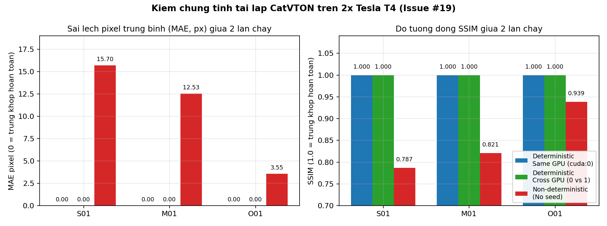
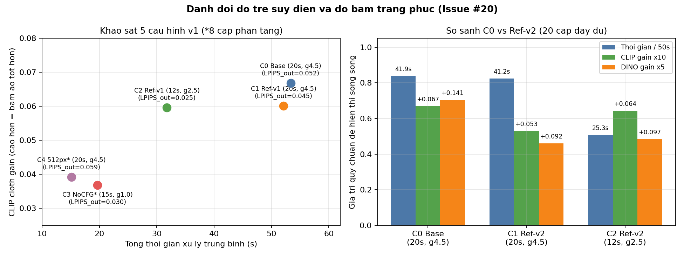
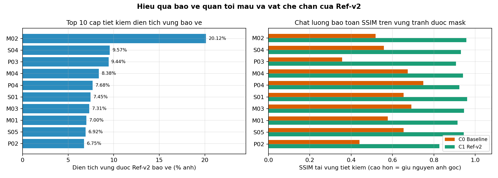
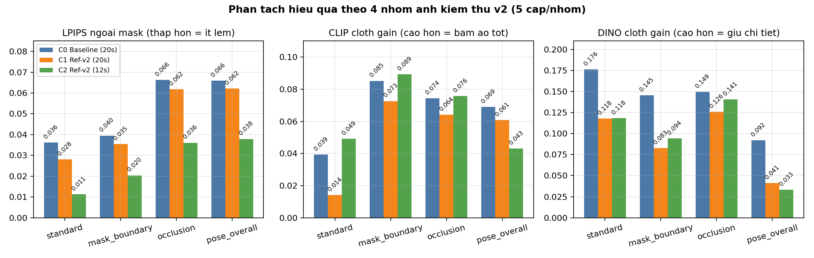

# Báo cáo thực nghiệm và khắc phục lỗi Tuần 8 (`Issue #19`, `Issue #20`)

Tài liệu này tổng hợp quá trình điều tra nguyên nhân gốc rễ, sửa lỗi trên mã nguồn, thiết kế tập kiểm thử cố định 20 cặp và kết quả thực nghiệm thực tế trên Kaggle GPU (`2x Tesla T4`) cho hai issue mở của Tuần 8:

- **Issue #19**: Tính có thể tái lập của benchmark chưa ổn định.
- **Issue #20**: CatVTON chậm và lỗi nhiều ở pose / mask / occlusion.

---

## 1. Môi trường thực thi và tập dữ liệu kiểm chứng

Thông số môi trường đo trực tiếp từ phiên chạy Kaggle (`results_v2/env_manifest.json`):

- Python: `3.13.16`
- PyTorch: `2.11.0+cu130` (CUDA `13.0`, cuDNN `92700`)
- `diffusers`: `0.32.2`, `transformers`: `4.49.0`
- Phần cứng GPU: `2x Tesla T4`
- Tập dữ liệu cố định (`neitng/datn-w08-frozen-vton-set`, kiểm toàn vẹn SHA-256 trong `frozen_pairs_w08.json`): gồm 20 cặp chia thành 4 nhóm (5 cặp/nhóm):
  1. `standard` (`S01`–`S05`): áo phông/áo kiểu nền sáng, tư thế thẳng.
  2. `mask_boundary` (`M01`–`M05`): áo dài tay thử áo cộc, áo tối màu trùng quần tối màu (`M02`), áo trắng trên nền trắng (`M03`), áo khoác tối trên nền đen (`M05`).
  3. `occlusion` (`O01`–`O05`): có túi xách, cốc cà phê, cốc trà sữa, kính râm hoặc tóc che phía trước.
  4. `pose_overall` (`P01`–`P05`): chống tay lên hông (`P01`, `P04`), giơ tay chữ V (`P02`), góc nghiêng (`P03`), đầm/váy dài (`P05` với `category = overall`).

Giới hạn dữ liệu: bộ ảnh `datacard/` và `image_person_with_bag/` tại local chỉ có ảnh sản phẩm flat-lay cho `upper` (19 cặp) và `overall` (1 cặp `P05`), không có flat-lay tách riêng cho `lower` (quần/chân váy). Do đó nhánh `lower` mới được kiểm tra bằng unit test, chưa có số liệu thực nghiệm trên GPU ở tuần này.

---

## 2. Kết quả xử lý Issue #19: Tính có thể tái lập của benchmark

### 2.1. Các thay đổi đã triển khai

1. **Khóa danh sách cặp và seed theo từng cặp** (`scripts/w08_frozen_manifest.py`, `frozen_pairs_w08.json`): mỗi cặp được gán cố định `person_sha256`, `cloth_sha256`, `category` và `pair_seed` (tính tất định từ `pair_id`, độc lập với thứ tự duyệt trong danh sách).
2. **Đặt chế độ tất định trên pipeline và API server** (`backend-ai/app/api/routes/tryon.py`, `backend-ai/notebooks/catvton-api-server.ipynb`, `scripts/benchmark_vton_profiling.py`):
   - Bật `torch.backends.cudnn.deterministic = True` và `torch.backends.cudnn.benchmark = False`.
   - Khởi tạo riêng `torch.Generator(device=...).manual_seed(pair_seed)` cho từng cặp khi chạy song song 2 luồng (`ThreadPoolExecutor(2)`), thay cho việc dùng chung một biến seed toàn cục `SEED = 42`.
   - Mở thêm các tham số điều khiển qua API (`/api/tryon`, `/api/v1/tryon`): `seed`, `steps`, `guidance_scale`, `mask_mode`, và trả về mã commit CatVTON trong `/api/health`.
3. **Đánh giá trên vùng thống nhất (unified region)** trong notebook thực nghiệm (`w08_catvton_experiment.ipynb`): khi so sánh các cấu hình mask khác nhau, `LPIPS_out_unified` và `SSIM_out_unified` được tính trên cùng phần nền ngoài vùng `dilate(mask_C0, 16)` để tránh sai lệch lợi thế do diện tích mask khác nhau.

### 2.2. Số liệu kiểm chứng trên GPU (`results_v1/reproducibility_check.csv`, `results_v2/reproducibility_check.csv`)

| Cặp | So sánh | MAE pixel (px) | Sai lệch tối đa (px) | Tỉ lệ pixel trùng (%) | SSIM |
| :--- | :--- | ---: | ---: | ---: | ---: |
| `S01` (v1) | Chạy lặp cùng `cuda:0` (đã khóa seed) | 0.00000 | 0.0 | 100.00 | 1.000000 |
| `S01` (v1) | Chéo GPU `cuda:0` vs `cuda:1` (đã khóa seed) | 0.00000 | 0.0 | 100.00 | 1.000000 |
| `S01` (v1) | Không khóa generator (`NoSeed_RunD`) | 15.70034 | 254.0 | 0.04 | 0.786820 |
| `M01` (v1) | Chạy lặp cùng `cuda:0` (đã khóa seed) | 0.00000 | 0.0 | 100.00 | 1.000000 |
| `M01` (v1) | Chéo GPU `cuda:0` vs `cuda:1` (đã khóa seed) | 0.00000 | 0.0 | 100.00 | 1.000000 |
| `M01` (v1) | Không khóa generator (`NoSeed_RunD`) | 12.53345 | 255.0 | 1.07 | 0.820537 |
| `O01` (v1) | Chạy lặp cùng `cuda:0` (đã khóa seed) | 0.00000 | 0.0 | 100.00 | 1.000000 |
| `O01` (v1) | Chéo GPU `cuda:0` vs `cuda:1` (đã khóa seed) | 0.00000 | 0.0 | 100.00 | 1.000000 |
| `O01` (v1) | Không khóa generator (`NoSeed_RunD`) | 3.55115 | 202.0 | 1.47 | 0.938662 |
| `S01` (v2) | Chạy lặp `cuda:0` / Chéo `cuda:0` vs `cuda:1` | 0.00000 | 0.0 | 100.00 | 1.000000 |

Kết luận cho Issue #19: sau khi cố định manifest có SHA-256, gán `pair_seed` theo cặp và bật chế độ cuDNN tất định, kết quả suy diễn trùng khớp từng pixel (`MAE = 0.0`, `SSIM = 1.0`) cả khi lặp lại trên cùng GPU lẫn khi chia shard sang `cuda:1`. Bộ kiểm thử unit test cục bộ (`scripts/test_w08_fixes.py`) xác minh thêm tính bất biến của seed khi đảo thứ tự danh sách đầu vào.

---

## 3. Kết quả xử lý Issue #20: Độ trễ suy diễn và lỗi pose / mask / occlusion

### 3.1. Phân tích định lượng giữa các cấu hình (v1 và v2)

| Phiên bản | Cấu hình | Số cặp | Tiền xử lý (s) | Suy diễn UNet (s) | Tổng thời gian (s) | VRAM (GB) | Diện tích mask (%) | LPIPS ngoài mask | SSIM ngoài mask | CLIP cloth gain | DINO cloth gain |
| :--- | :--- | ---: | ---: | ---: | ---: | ---: | ---: | ---: | ---: | ---: | ---: |
| v1 | `C0_baseline_s20_g45` | 20 | 1.1217 | 52.2341 | 53.3559 | 4.333 | 26.0535 | 0.0520 | 0.9353 | +0.0668 | +0.1407 |
| v1 | `C1_refined_s20_g45` | 20 | 0.0898 | 52.0360 | 52.1259 | 4.333 | 18.0125 | 0.0450 | 0.9373 | +0.0601 | +0.0890 |
| v1 | `C2_refined_s12_g25` | 20 | 0.0915 | 31.6673 | 31.7588 | 4.333 | 18.0125 | 0.0253 | 0.9494 | +0.0596 | +0.0925 |
| v1 | `C3_refined_s15_g10` (No-CFG) | 8 | 0.4990 | 19.1593 | 19.6584 | 4.332 | 19.0038 | 0.0301 | 0.9423 | +0.0368 | +0.0680 |
| v1 | `C4_refined_512_s20` (`512x768`) | 8 | 0.8044 | 14.3433 | 15.1477 | 3.664 | 20.7312 | 0.0588 | 0.9239 | +0.0392 | +0.0778 |
| v2 | `C0_baseline_s20_g45` | 20 | 1.0190 | 40.8563 | 41.8752 | 4.333 | 26.0535 | 0.0520 | 0.9353 | +0.0669 | +0.1407 |
| v2 | `C1_refined_s20_g45` | 20 | 0.1319 | 41.0790 | 41.2110 | 4.333 | 19.3185 | 0.0468 | 0.9366 | +0.0529 | +0.0920 |
| v2 | `C2_refined_s12_g25` | 20 | 0.1345 | 25.2122 | 25.3467 | 4.333 | 19.3185 | 0.0264 | 0.9491 | +0.0643 | +0.0966 |

*(Ghi chú: thời gian tuyệt đối của `C0` giảm từ `53.36s` ở v1 xuống `41.88s` ở v2 do dao động tài nguyên máy chủ Kaggle dùng chung; mức cải thiện tương đối giữa `C2` so với `C0` giữ ổn định quanh `39.5%`–`40.5%`.)*

### 3.2. Các điểm đã giải quyết được

1. **Giảm ~40% độ trễ suy diễn và ~87% chi phí tiền xử lý lặp lại**:
   - Đổi từ `20 bước, guidance_scale = 4.5` sang `12 bước, guidance_scale = 2.5` (`C2`) cắt giảm thời gian suy diễn UNet từ `40.86s` xuống `25.21s` (v2) và `52.23s` xuống `31.67s` (v1), đồng thời giảm `LPIPS_out_unified` xuống còn khoảng một nửa (`0.0264` so với `0.0520`) và giữ `CLIP_cloth_gain` tiệm cận `C0` (`+0.0643` so với `+0.0669`).
   - Cache `AutoMasker` (`PRE_CACHE` / `AUTOMASK_CACHE` theo SHA-256 ảnh người mẫu) rút thời gian tiền xử lý khi thử áo mới trên cùng người mẫu từ `1.019s`–`1.122s` xuống `0.090s`–`0.132s`.
   - Thử nghiệm nhánh tắt CFG (`C3`, `19.66s`) làm `CLIP_cloth_gain` tụt mạnh còn `+0.0368`, còn giảm phân giải `512x768` (`C4`, `15.15s`) làm tăng nhiễu ngoài mask (`LPIPS_out = 0.0588`). Do đó cả `C3` và `C4` đều bị loại khỏi cấu hình khuyến nghị.
2. **Bảo vệ vùng quần tối màu và vật cản khi bật `mask_mode="refined"`**:
   - Trên toàn bộ 20 cặp ở v2 (`results_v2/protected_region_analysis.csv`), `Ref-v2` giảm trung bình `6.74%` diện tích mask bị phình thừa so với `C0`.
   - Đặc biệt ở cặp `M02` (áo đen - quần đen), `Ref-v2` giữ nguyên được vùng quần chiếm `20.12%` diện tích ảnh (`SSIM` tại vùng này tăng từ `0.5187` ở `C0` lên `0.9570`, `LPIPS` giảm từ `0.6421` xuống `0.1550`), sửa lỗi `C0` biến quần đen thành màu nâu.
   - Trên các ca có vật che (`O02`, `P05`), `Ref-v2` giữ nguyên được cốc cà phê, cạp quần trắng và túi xách (trong khi `C0` xóa mất túi xách ở `P05`). Phiên bản v2 cũng sửa dứt điểm lỗi cắt ngang gấu áo khoác xanh ở `P01` gặp phải ở v1.

### 3.3. Hạn chế còn lại và đánh đổi của `mask_mode="refined"` (báo cáo trung thực)

So sánh 4 nhóm ảnh ở `results_v2/summary_by_group.csv` và kiểm tra trực quan 20 ảnh lưới (`results_v2/grids/`) cho thấy `C1/C2` sử dụng `refined_cloth_agnostic_mask` đạt `LPIPS_out` và `SSIM_out` tốt hơn `C0`, nhưng `DINO_cloth_gain` thấp hơn `C0` (`+0.0920` / `+0.0966` so với `+0.1407`):

Nguyên nhân kỹ thuật quan sát được qua đối chiếu từng cặp:

1. **Sót viền mỏng `2–5 px` tại ranh giới vùng bảo vệ (`M01`, `M04`, `O03`, `O04`, `P04`, `S02`)**: khi loại bỏ `hull_mask` và trừ lại toàn bộ `Hair`, `Pants`, `Bag`, `Hands` ở bước cuối, sai số biên của SCHP tại cổ tay hoặc cổ áo để lại viền màu áo cũ sát rìa mask. Pipeline inpainting dựa trên ngữ cảnh biên chưa bị mask đã kéo dài dải màu/tay áo cũ vào vùng sinh ảnh.
2. **Khuyết vùng cổ và vai trên hở hoặc áo sáng trùng nền (`S01`, `S04`, `P03`)**: CatVTON gốc (`C0`) được huấn luyện trên phân phối mask phình rộng lên sát cằm và vượt ra ngoài vai ~20 px. Khi thu gọn mask sát giải phẫu, các khoảng lõm mở ở xương quai xanh (`S01`, `S04`) hoặc ranh giới phom áo blazer rộng (`P01`) không được che hết khiến UNet giữ lại chi tiết áo cũ hoặc lấp theo phom áo khoác cũ.
3. **Kết quả âm cho áo trắng trên nền trắng (`M03`)**: thuật toán đệm nền `#E8E6E0` trong `preprocess_cloth_for_tryon` kích hoạt đúng (`white_cloth_trig=True`), nhưng kết quả sinh ở cả `C0`, `C1` và `C2` đều xuất hiện nhiễu lưới tối trên thân áo trắng. Điều này cho thấy hạn chế nằm trong cơ chế nén/attention nội tại của VAE và Reference UNet khi nhận trang phục ít tương phản, không thể giải quyết hoàn toàn bằng tiền xử lý màu nền.

Do kết quả đánh đổi này, cấu hình mặc định trên `/api/tryon` và `/api/v1/tryon` được đặt về **`steps = 12, guidance_scale = 2.5, mask_mode = "baseline"`** (ưu tiên độ khớp dáng áo và tốc độ ~`25s–32s`), đồng thời giữ **`mask_mode = "refined"`** dưới dạng tùy chọn cho các tình huống người mẫu cầm túi/cốc trước ngực hoặc mặc áo-quần tối màu tiệp nhau.

---

## 4. Danh mục tệp bằng chứng và chuỗi commit

- [audit tái lập (#19)](issue_19_reproducibility_audit.md)
- [chẩn đoán mask và độ trễ (#20)](issue_20_mask_latency_diagnosis.md)
- [ghi nhận thực nghiệm v1 (bao gồm lỗi mặt nạ)](v1_experiment_observations.md)
- [ghi nhận thực nghiệm v2 (mask v2 và đánh đổi)](v2_experiment_observations.md)
- [manifest tập 20 cặp đóng băng](frozen_pairs_w08.json) và [tệp tạo manifest](../../scripts/w08_frozen_manifest.py)
- [bộ hiệu chỉnh mặt nạ v2](../../backend-ai/app/services/catvton_mask_refiner.py)
- [unit tests cục bộ](../../scripts/test_w08_fixes.py) (`5/5` test case đạt `OK`)
- [notebook kiểm chứng trên Kaggle](w08_catvton_experiment.ipynb) (`neitng/datn-w08-vton-experiment`)
- Thư mục số liệu & ảnh lưới: `results_v1/`, `results_v2/`, `figures/`
