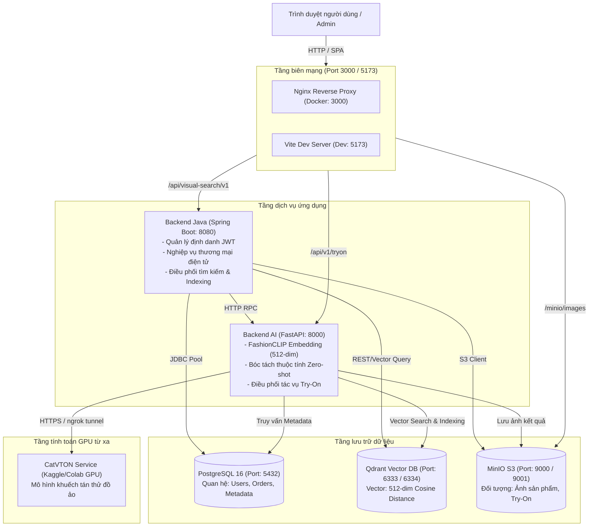

# Hệ thống quản lý cửa hàng thời trang tích hợp tìm kiếm đa phương thức và thử đồ ảo

Hệ thống ứng dụng thương mại điện tử chuyên ngành thời trang cao cấp, tích hợp hai mô-đun trí tuệ nhân tạo chuyên sâu: tìm kiếm đa phương thức (Multimodal Visual Search bằng văn bản tự nhiên và hình ảnh qua FashionCLIP) và phòng thử đồ ảo (AI Virtual Try-On qua mô hình khuếch tán CatVTON).

---

## 1. Tổng quan hệ thống

Dự án được nghiên cứu và phát triển theo định hướng giải quyết bài toán cốt lõi trong thương mại điện tử thời trang: tối ưu hóa hành trình khám phá sản phẩm và giảm thiểu tỷ lệ hoàn trả hàng (return rate) thông qua công nghệ thị giác máy tính và học sâu.

Hệ thống bao gồm ba trụ cột nghiệp vụ:
1. **Tìm kiếm đa phương thức (Multimodal Retrieval)**: Tiếp nhận truy vấn văn bản tự nhiên (tiếng Việt/tiếng Anh) hoặc hình ảnh tải lên từ người dùng; thực hiện trích xuất vector đặc trưng trong không gian 512 chiều của mô hình FashionCLIP; kết hợp bóc tách thuộc tính tự động (loại trang phục, màu sắc, phong cách, chất liệu, giới tính) và đối sánh khoảng cách cosine trên cơ sở dữ liệu vector Qdrant.
2. **Thử đồ ảo thông minh (AI Virtual Try-On Studio)**: Phòng thử đồ 3 cột cho phép khách hàng ướm thử trang phục bất kỳ lên ảnh người mẫu cá nhân; điều phối tác vụ tính toán khuếch tán (diffusion) qua mô hình CatVTON chạy trên máy chủ GPU; có cơ chế lưu trữ bảo vệ quyền riêng tư và tự động dọn dẹp dữ liệu người dùng.
3. **Nền tảng thương mại điện tử hoàn chỉnh (Fashion E-Commerce Core)**: Quản lý danh mục 24 mã sản phẩm (SKU) với thông số kỹ thuật xuất khẩu, hệ thống giỏ hàng tương tác, áp dụng mã ưu đãi, quy trình thanh toán đa phương thức và cổng quản trị (Admin Portal) theo dõi chỉ mục, dữ liệu và đơn hàng.

---

## 2. Kiến trúc tổng thể và luồng dữ liệu



---

## 3. Bảng cổng lắng nghe và định tuyến mạng

Bảng dưới đây thống kê chi tiết toàn bộ các cổng mạng (listening ports), giao thức, địa chỉ liên kết và điểm kiểm tra sức khỏe của từng dịch vụ trong toàn bộ hệ thống:

| Cổng máy chủ (Host Port) | Cổng container (Target Port) | Giao thức | Dịch vụ (Service) | Địa chỉ truy cập cục bộ | Trách nhiệm và chức năng | Điểm kiểm tra sức khỏe (Healthcheck) |
|---|---|---|---|---|---|---|
| **3000** | 80 | HTTP | `frontend` (Docker) | `http://localhost:3000` | Ứng dụng web người dùng và quản trị chạy qua Nginx reverse proxy | `GET http://localhost/` |
| **5173** | 5173 | HTTP | `frontend` (Vite Dev) | `http://localhost:5173` | Máy chủ phát triển Frontend hỗ trợ Hot Module Replacement (HMR) | N/A (Môi trường dev) |
| **8080** | 8080 | HTTP | `backend-java` | `http://localhost:8080` | API Gateway, xác thực JWT, quản lý sản phẩm, đơn hàng, dấu trang, lịch sử tìm kiếm | `GET /actuator/health` |
| **8000** | 8000 | HTTP | `backend-ai` | `http://localhost:8000` | Trích xuất vector FashionCLIP, phân tích thuộc tính trang phục, chuyển tiếp tác vụ thử đồ ảo | `GET http://localhost:8000/health` |
| **5432** | 5432 | TCP | `postgres` | `localhost:5432` | Cơ sở dữ liệu quan hệ PostgreSQL 16 lưu người dùng, siêu dữ liệu ảnh và đơn hàng | `pg_isready -U postgres -d imagesearch` |
| **6333** | 6333 | HTTP | `qdrant` (REST) | `http://localhost:6333` | Cơ sở dữ liệu vector tiếp nhận truy vấn đối sánh khoảng cách cosine và lọc payload | `GET http://localhost:6333/healthz` |
| **6334** | 6334 | gRPC | `qdrant` (gRPC) | `localhost:6334` | Kênh truyền thông gRPC hiệu năng cao phục vụ truy vấn vector hàng loạt | N/A (Internal RPC) |
| **9000** | 9000 | HTTP | `minio` (S3 API) | `http://localhost:9000` | Dịch vụ lưu trữ đối tượng tương thích Amazon S3 lưu ảnh gốc và ảnh trung gian | `mc ready local` |
| **9001** | 9001 | HTTP | `minio` (Console) | `http://localhost:9001` | Giao diện đồ họa web quản trị bucket, chính sách truy cập và tệp đối tượng MinIO | N/A (Web UI) |
| **8000 (GPU)** | 8000 | HTTPS | `catvton-service` | Đường hầm qua `pyngrok` (`https://*.ngrok-free.app/api/tryon`) | Máy chủ tính toán suy luận mô hình khuếch tán CatVTON chạy trên GPU NVIDIA T4/P100 | `GET /health` |

### Quy tắc định tuyến của Nginx Reverse Proxy (Cổng 3000)

Khi khởi chạy bằng Docker Compose, container `frontend` tiếp nhận toàn bộ lưu lượng tại cổng 3000 và phân luồng như sau:
- `/api/visual-search/v1/*` được chuyển tiếp tới `http://backend-java:8080/visual-search/v1/*`
- `/api/v1/tryon/*` được chuyển tiếp tới `http://backend-ai:8000/api/v1/tryon/*`
- `/minio/images/*` được chuyển tiếp tới `http://minio:9000/images/*`
- Các đường dẫn còn lại được chuyển tới tệp tĩnh `index.html` của ứng dụng React Single Page Application (SPA).

---

## 4. Dữ liệu và nguồn tài nguyên trong kho mã nguồn

Hệ thống được đóng gói với đầy đủ dữ liệu cấu hình, tập mẫu trang phục, cơ sở dữ liệu giả lập và sổ tay huấn luyện/suy luận:

### 4.1. Mô hình trí tuệ nhân tạo và sổ tay tính toán (`backend-ai/notebooks`)
- `backend-ai/notebooks/cat-vton.ipynb`: Quy trình nạp mô hình khuếch tán CatVTON, tiền xử lý mặt nạ trang phục, chuẩn hóa tỷ lệ kích thước ảnh và kiểm thử suy luận thử đồ trên dữ liệu mẫu chuẩn VITON-HD.
- `backend-ai/notebooks/catvton-api-server.ipynb`: Mã nguồn máy chủ FastAPI hoàn chỉnh chạy trên môi trường Google Colab hoặc Kaggle (GPU T4 x2/P100), tích hợp thư viện `pyngrok` để tạo đường hầm HTTPS phục vụ trực tiếp cho API `/api/v1/tryon`.
- `OpenCLIP ViT-B-32-quickgelu`: Mô hình thị giác máy tính trích xuất vector 512 chiều được nạp tự động vào bộ nhớ đệm container (`base_model_cache`).

### 4.2. Dữ liệu mẫu trang phục và người mẫu thực tế (`frontend/public/samples/`)
- Mẫu trang phục thực tế chuẩn bị sẵn cho phòng thử đồ Studio:
  - `cloth-1.jpg`: Áo polo dệt kim retro khóa zip kim loại.
  - `cloth-2.webp`: Áo thun cổ tròn graphic owl định lượng 280gsm.
  - `cloth-white-tee.webp`: Áo phông trắng basic dáng suông.
  - `cloth-polo-black.jpg`: Áo polo đen charcoal cổ viền dệt.
- Mẫu người mẫu ảnh chuẩn phục vụ thử đồ:
  - `model-1.jpg`: Người mẫu nam phông nền studio tiêu chuẩn.
  - `model-female-hero.jpg`: Người mẫu nữ tạo dáng thời trang.

### 4.3. Cơ sở dữ liệu danh mục sản phẩm thời trang (`frontend/src/mocks/catalogData.js`)
Dữ liệu mô phỏng doanh nghiệp gồm 24 mã sản phẩm thời trang phân bổ qua các phân loại chính:
- **Áo (Upper)**: Áo polo dệt kim, áo thun heavyweight, áo sơ mi oxford kẻ sọc, áo khoác blazer hai hàng khuy, áo nỉ hoodie cotton, áo len cardigan merino.
- **Quần (Lower)**: Quần jeans ống đứng denim 13oz, quần âu may đo pleated trouser, quần kaki chino co giãn, quần short linen thoáng mát.
- **Trang phục toàn thân (Overall)**: Đầm lụa maxi satin cao cấp, áo măng tô dạ dáng dài (trench coat), bộ jumpsuit linen dạo phố.
- **Phụ kiện (Accessories)**: Giày sneaker da thủ công, túi tote da thảo mộc, thắt lưng da khóa đồng.

Mỗi sản phẩm có đầy đủ các trường dữ liệu tiêu chuẩn:
- Mã định danh SKU duy nhất (`LAT-POLO-001`, `LAT-BLZ-003`,...).
- Chất liệu, xuất xứ tiêu chuẩn xuất khẩu, mô tả tính năng.
- Bảng kích thước (S, M, L, XL) kèm số lượng tồn kho từng size.
- Bảng màu sắc kèm mã màu HEX trực quan (`#1e293b`, `#111827`,...).
- Đơn giá niêm yết bằng Việt Nam Đồng (VND), giá khuyến mãi và đánh giá thực tế.

### 4.4. Từ điển nhãn thuộc tính thời trang (`frontend/src/mocks/searchResultsMock.js`)
Hệ thống phân loại đa thuộc tính phục vụ lọc kết quả tìm kiếm gồm:
- **Danh mục (Category)**: upper, lower, overall, shoes, bag, accessory.
- **Màu sắc (Color)**: đen, trắng, xanh navy, be, xám, đỏ mận, xanh rêu, nâu đất.
- **Họa tiết (Pattern)**: trơn (solid), sọc (striped), caro (plaid), hoa văn (floral), graphic.
- **Phong cách (Style)**: tối giản (minimalist), công sở (formal), đường phố (streetwear), cổ điển (vintage).
- **Phom dáng (Fit)**: slim-fit, regular-fit, oversized, relaxed.

### 4.5. Cơ sở dữ liệu quan hệ và cơ chế lưu trữ
- **PostgreSQL 16**: Quản lý phiên bản bảng tự động qua công cụ Flyway Migration (`V20260716__remove_batch_indexing_workflow.sql`). Lưu trữ cấu trúc người dùng, quyền hạn, ảnh sản phẩm, siêu dữ liệu OCR, tác vụ indexing và lịch sử thử đồ.
- **Qdrant Vector Collection (`images`)**: Lưu trữ vector nhúng 512 chiều được lập chỉ mục kèm payload siêu dữ liệu thuộc tính để phục vụ truy vấn tương đồng ngữ nghĩa.
- **MinIO Object Bucket (`images`)**: Lưu trữ các tệp nhị phân của ảnh gốc, ảnh thumbnail và ảnh kết quả suy luận thử đồ.

---

## 5. Công nghệ sử dụng

| Phân hệ | Công nghệ và thư viện | Mục đích sử dụng |
|---|---|---|
| **Frontend** | React 19, Vite 8, Tailwind CSS 4 | Giao diện Single Page Application hiện đại, tải trang nhanh |
| **State & Data Fetching** | TanStack React Query 5, Axios | Quản lý bộ nhớ đệm dữ liệu máy chủ, phân trang vô hạn, đồng bộ trạng thái |
| **UI Components & Icons** | Lucide React, SweetAlert2 | Bộ biểu tượng vector chuẩn doanh nghiệp, hộp thoại xác nhận trực quan |
| **Backend Core** | Java 21, Spring Boot 3.3.0 | API Gateway, xác thực bảo mật, xử lý giao dịch nghiệp vụ thương mại điện tử |
| **Bảo mật** | Spring Security, JWT, HttpOnly Cookie | Cơ chế Access Token ngắn hạn và Refresh Token tự động gửi an toàn |
| **Cơ sở dữ liệu** | PostgreSQL 16, Spring Data JPA, Flyway | Lưu trữ quan hệ đảm bảo tính toàn vẹn dữ liệu ACID |
| **Backend AI** | Python 3.10, FastAPI, Uvicorn | Dịch vụ tính toán thị giác máy tính và bóc tách thuộc tính thời trang |
| **Thị giác máy tính** | OpenCLIP (`ViT-B-32-quickgelu`), PyTorch | Mô hình sinh vector ngữ nghĩa hình ảnh và văn bản chung không gian vector |
| **Thử đồ ảo (VTON)** | CatVTON (Diffusion Model), pyngrok | Suy luận ghép trang phục lên người mẫu dựa trên mạng khuếch tán |
| **Cơ sở dữ liệu vector** | Qdrant 1.12.1 | Tìm kiếm vector lân cận xấp xỉ (ANN) với bộ lọc thuộc tính |
| **Lưu trữ đối tượng** | MinIO (S3 Compatible Storage) | Lưu trữ tệp ảnh sản phẩm và ảnh thử đồ có chính sách bảo mật |
| **Hạ tầng & Triển khai** | Docker, Docker Compose, Nginx | Đóng gói môi trường đồng nhất, tự động hóa khởi chạy dịch vụ |

---

## 6. Hướng dẫn cài đặt và vận hành

### 6.1. Yêu cầu môi trường tối thiểu
- **Hệ điều hành**: Linux (Ubuntu 22.04 LTS), macOS, hoặc Windows 11 có WSL2.
- **Công cụ điều phối**: Docker Engine 24+ và Docker Compose v2.20+.
- **Bộ nhớ RAM**: Tối thiểu 8 GB khả dụng (khuyến nghị 16 GB).
- **Môi trường chạy máy khách (tùy chọn khi chạy không dùng Docker)**:
  - Node.js bản 20 trở lên và npm / pnpm.
  - Java OpenJDK 21.
  - Python 3.10+.

### 6.2. Khởi chạy toàn bộ hệ thống bằng Docker Compose

#### Bước 1: Sao chép tệp cấu hình môi trường
```bash
cp .env.example .env
```
Thiết lập các giá trị mật khẩu bí mật trong `.env`:
- `POSTGRES_PASSWORD`: Mật khẩu cơ sở dữ liệu PostgreSQL.
- `MINIO_ROOT_PASSWORD`: Mật khẩu quản trị MinIO.
- `JWT_SECRET`: Chuỗi khóa ký mã thông báo JWT bảo mật.
- `APP_ADMIN_PASSWORD`: Mật khẩu tài khoản quản trị mặc định.

#### Bước 2: Khởi chạy cụm dịch vụ
```bash
docker compose up -d
```

#### Bước 3: Kiểm tra trạng thái hoạt động của các dịch vụ
```bash
docker compose ps
```
Kết quả hiển thị trạng thái `healthy` hoặc `Up` cho toàn bộ các container:
- `visual-search-engine-postgres`
- `visual-search-engine-qdrant`
- `visual-search-engine-minio`
- `visual-search-engine-createbuckets` (trạng thái `Exited (0)` sau khi hoàn thành tạo bucket)
- `visual-search-engine-backend-ai`
- `visual-search-engine-backend-java`
- `visual-search-engine-frontend`

---

### 6.3. Cấu hình tính năng thử đồ ảo CatVTON (GPU từ xa)

Để kích hoạt tính năng thử đồ ảo thực tế bằng mô hình khuếch tán:
1. Tạo một sổ tay mới trên Kaggle (chọn GPU T4 x2 hoặc P100) hoặc Google Colab (chọn GPU T4).
2. Tải tệp sổ tay `backend-ai/notebooks/catvton-api-server.ipynb` lên môi trường tính toán.
3. Nhập authtoken ngrok và thực thi các ô lệnh để khởi chạy máy chủ CatVTON tại cổng 8000:
   ```python
   from pyngrok import ngrok
   public_url = ngrok.connect(8000).public_url
   print("Dia chi cong khai:", public_url)
   ```
4. Lấy địa chỉ công khai (ví dụ: `https://xxxx-xx-xx-xx.ngrok-free.app`), gắn thêm đường dẫn API `/api/tryon` và cập nhật vào biến `CATVTON_SERVICE_URL` trong tệp `.env`:
   ```env
   CATVTON_SERVICE_URL=https://xxxx-xx-xx-xx.ngrok-free.app/api/tryon
   CATVTON_TIMEOUT_SECONDS=120
   ```
5. Khởi động lại dịch vụ `backend-ai` để nạp cấu hình mới:
   ```bash
   docker compose restart backend-ai
   ```

*Ghi chú: Nếu chưa thiết lập máy chủ GPU cho CatVTON, hệ thống frontend vẫn hoạt động bình thường với cơ chế thử đồ trực quan và dữ liệu mẫu có sẵn.*

---

### 6.4. Chạy từng dịch vụ trong môi trường phát triển cục bộ (Local Dev)

Khi cần phát triển và kiểm thử từng phần riêng biệt mà không đóng gói qua container:

#### Khởi chạy dịch vụ phụ trợ (Hạ tầng lưu trữ)
```bash
docker compose up -d postgres qdrant minio createbuckets
```

#### Khởi chạy Frontend React
```bash
cd frontend
npm install
npm run dev
```
Giao diện phát triển lắng nghe tại: `http://localhost:5173`.

#### Khởi chạy Backend Java
```bash
cd backend-java
./mvnw spring-boot:run
```
Dịch vụ lắng nghe tại: `http://localhost:8080`.

#### Khởi chạy Backend AI
```bash
cd backend-ai
python -m venv .venv
source .venv/bin/activate  # Trên Windows: .venv\Scripts\Activate.ps1
pip install -r requirements.txt
uvicorn app.main:app --host 0.0.0.0 --port 8000 --reload
```
Dịch vụ lắng nghe tại: `http://localhost:8000`.

---

## 7. Tài khoản kiểm thử mặc định

| Vai trò người dùng | Tên đăng nhập / Email | Mật khẩu mặc định | Quyền hạn và phạm vi truy cập |
|---|---|---|---|
| **Quản trị viên (Admin)** | `admin` / `admin@example.com` | Giá trị cấu hình tại `APP_ADMIN_PASSWORD` | Toàn quyền quản trị: Dashboard giám sát, quản lý kho ảnh, theo dõi tiến trình indexing, quản lý thùng rác |
| **Khách hàng (Customer)** | Đăng ký tự do tại màn hình `/register` | Tùy chọn khi đăng ký | Mua sắm, tìm kiếm đa phương thức, phòng thử đồ ảo Studio, giỏ hàng và theo dõi đơn hàng |

---

## 8. Cấu trúc thư mục dự án

```text
DATN/
├── .env.example                 # Mẫu khai báo biến môi trường chuẩn
├── .gitignore                   # Cấu hình bỏ qua tệp tin toàn dự án
├── docker-compose.yml           # Khai báo điều phối cụm dịch vụ hệ thống
├── docker-compose.build.yml     # Khai báo cấu hình xây dựng image cục bộ
├── README.md                    # Tài liệu hướng dẫn kỹ thuật chính của dự án
├── thiet-ke-he-thong-chi-tiet.md# Tài liệu thiết kế hệ thống chi tiết (System Design Document)
│
├── backend-ai/                  # Dịch vụ trí tuệ nhân tạo (FastAPI & PyTorch)
│   ├── app/                     # Mã nguồn ứng dụng FastAPI
│   │   ├── api/routes/          # Các endpoint: search, indexing, tryon
│   │   ├── clients/             # Trình kết nối: Postgres, Qdrant, MinIO
│   │   ├── embedding/           # Logic trích xuất vector FashionCLIP
│   │   └── services/            # Tác vụ lập chỉ mục ngầm và xử lý ảnh
│   ├── notebooks/               # Sổ tay tính toán CatVTON và máy chủ API
│   │   ├── cat-vton.ipynb       # Quy trình thử đồ khuếch tán trên Colab/Kaggle
│   │   └── catvton-api-server.ipynb # Máy chủ phục vụ API thử đồ qua ngrok
│   ├── Dockerfile               # Định nghĩa container dịch vụ AI
│   └── requirements.txt         # Danh mục thư viện Python phụ thuộc
│
├── backend-java/                # Dịch vụ nghiệp vụ và API Gateway (Spring Boot)
│   ├── src/main/java/           # Mã nguồn Java: auth, search, tryon, index
│   ├── src/main/resources/      # Cấu hình ứng dụng và Flyway migration
│   ├── visual-search-engine-api-docs.md # Đặc tả chi tiết các REST API
│   ├── Dockerfile               # Định nghĩa container dịch vụ Java
│   └── pom.xml                  # Quản lý thư viện phụ thuộc Maven
│
└── frontend/                    # Giao diện ứng dụng web (React 19 + Vite + Tailwind)
    ├── public/samples/          # Mẫu trang phục và người mẫu Studio thực tế
    ├── src/
    │   ├── components/
    │   │   ├── common/          # FittingStudio, GarmentCatalog, CartDrawer,...
    │   │   └── ui/              # Navbar, Footer, SidebarAdmin,...
    │   ├── contexts/            # CartContext, WishlistContext, AuthContext
    │   ├── layouts/             # MainLayout, AdminLayout
    │   ├── mocks/               # catalogData (24 SKU), searchResultsMock
    │   ├── pages/               # Home, Catalog, ProductDetail, TryOn, Cart, Checkout, Orders
    │   │   └── admin/           # AdminDashboard, AdminProducts, AdminOrders,...
    │   ├── routes/              # AppRoutes quản lý định tuyến và phân quyền
    │   └── services/            # catalogService, orderService, tryonService,...
    ├── Dockerfile               # Định nghĩa container đóng gói qua Nginx
    ├── nginx.conf               # Cấu hình Nginx reverse proxy phân luồng
    └── package.json             # Danh mục thư viện phụ thuộc Node.js
```

---

## 9. Giấy phép sử dụng

Dự án được thực hiện phục vụ mục đích nghiên cứu và bảo vệ đồ án tốt nghiệp kỹ sư ngành Công nghệ Thông tin. Mọi quyền sao chép, sử dụng mã nguồn tuân thủ quy định học thuật của nhà trường.
