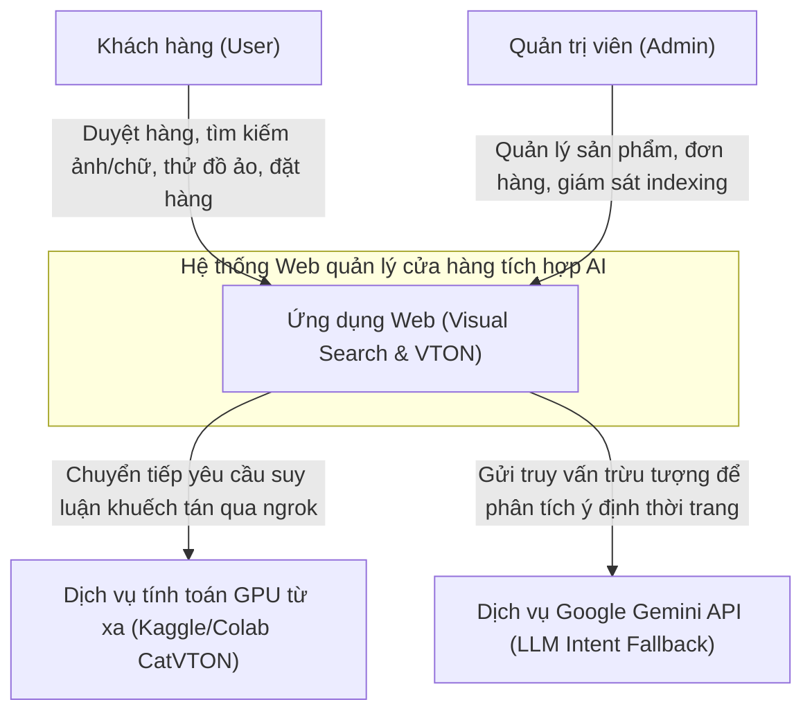
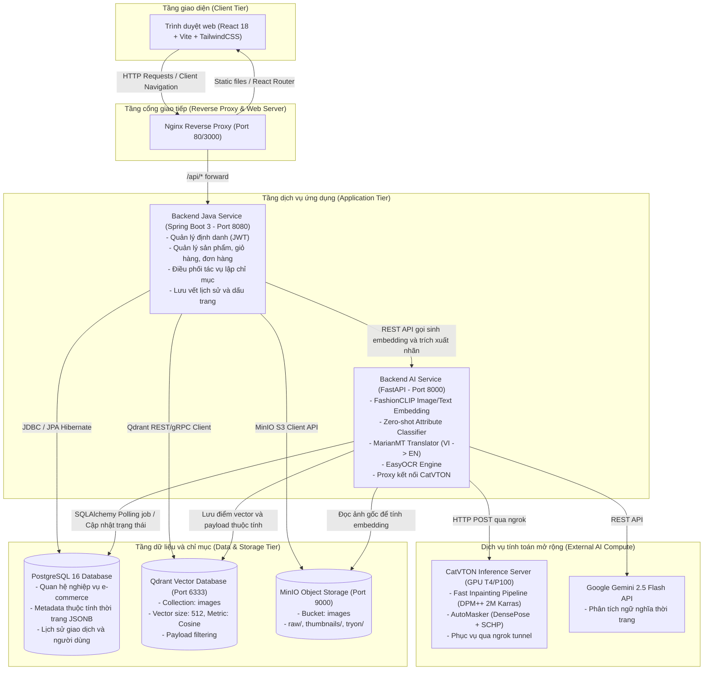
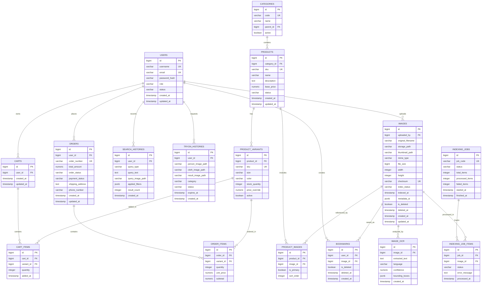
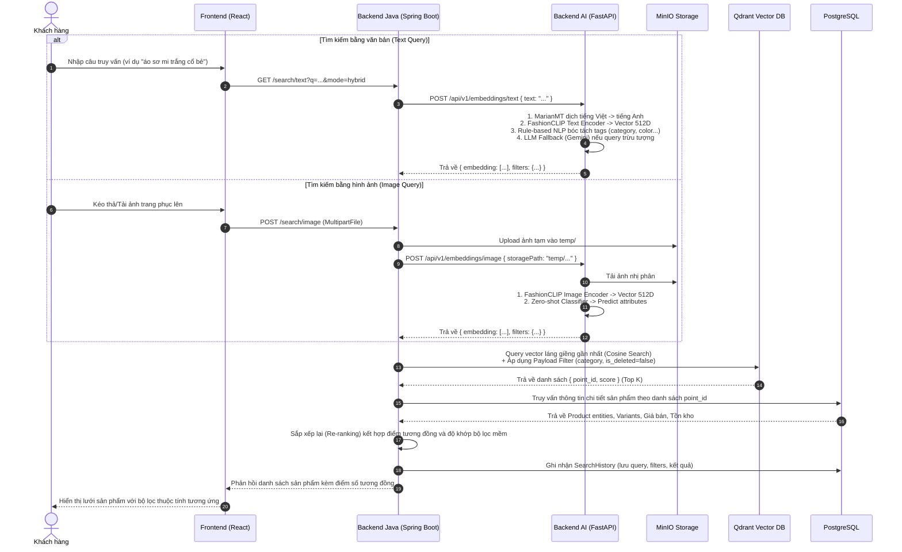
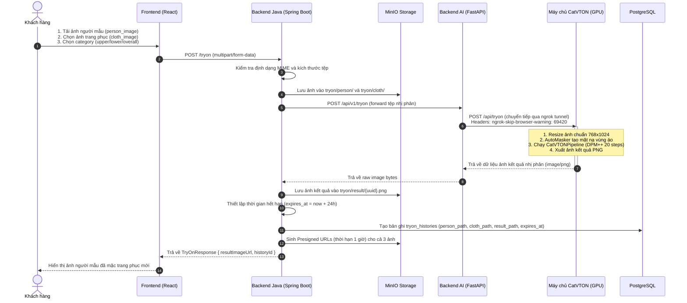
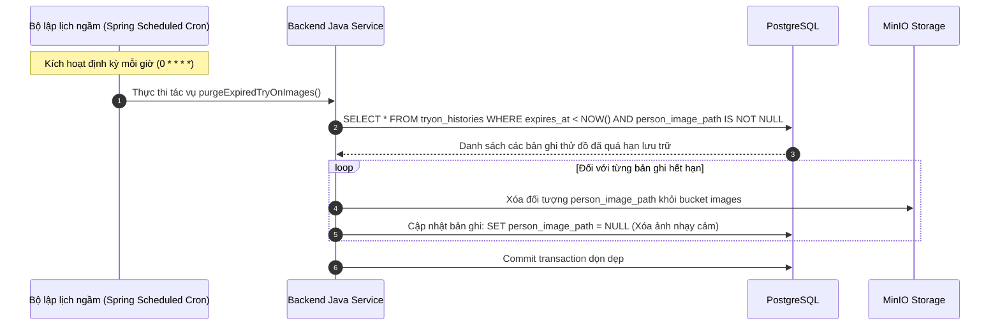
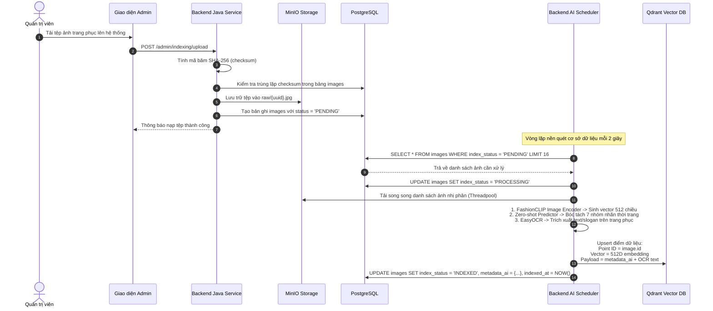
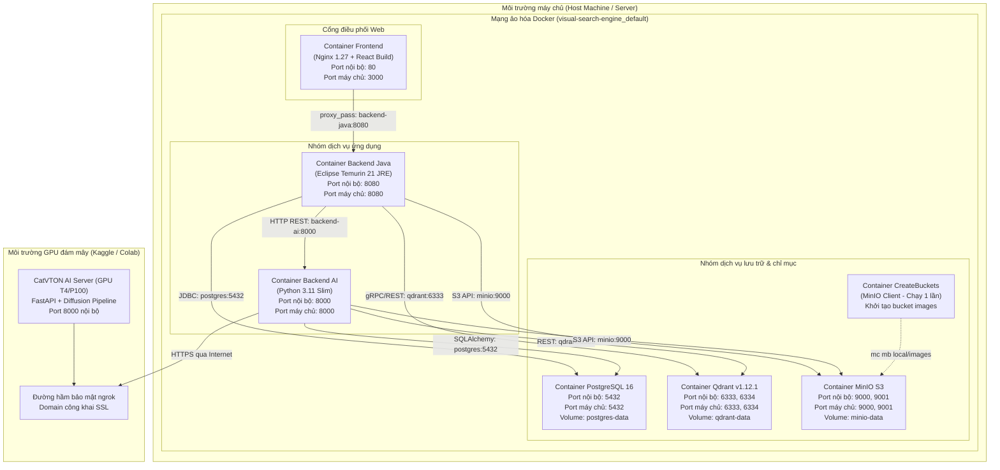

# Tài liệu thiết kế hệ thống chi tiết (System Design Document)

Dự án: Xây dựng ứng dụng web quản lý cửa hàng quần áo tích hợp tìm kiếm đa phương thức và thử đồ ảo  
Đối tượng sử dụng: Kỹ sư phần mềm, kỹ sư hệ thống, hội đồng đánh giá đồ án tốt nghiệp  

---

## 1. Tổng quan hệ thống và bối cảnh kiến trúc

### 1.1. Mục tiêu và phạm vi hệ thống
Hệ thống là một nền tảng thương mại điện tử chuyên ngành thời trang, kết hợp hai mô-đun trí tuệ nhân tạo (AI) phục vụ trải nghiệm mua sắm:
1. Mô-đun tìm kiếm đa phương thức (Multimodal Retrieval): Cho phép người dùng tìm kiếm sản phẩm bằng ngôn ngữ tự nhiên (tiếng Việt/tiếng Anh) hoặc bằng hình ảnh tải lên, kết hợp lọc theo thuộc tính thời trang bóc tách tự động (danh mục, màu sắc, phong cách, hoa văn, chất liệu, giới tính).
2. Mô-đun thử đồ ảo (Virtual Try-On - VTON): Cho phép người dùng ướm thử trang phục (ưu tiên trang phục nửa thân trên - upper body) lên ảnh chụp cá nhân dựa trên mô hình khuếch tán CatVTON, có cơ chế bảo vệ quyền riêng tư và tự động dọn dẹp dữ liệu người dùng.
3. Nghiệp vụ thương mại điện tử cốt lõi (E-commerce Core): Quản lý danh mục sản phẩm, biến thể (size, màu sắc, số lượng tồn kho), giỏ hàng, đặt hàng và quản trị đơn hàng.

### 1.2. Yêu cầu chức năng (Functional Requirements - FR)
- FR-01 (Quản lý định danh): Đăng ký, đăng nhập, cấp phát và thu hồi mã thông báo JWT (Access Token ngắn hạn và Refresh Token lưu trữ trong HttpOnly Cookie), phân quyền người dùng (USER, ADMIN).
- FR-02 (Quản trị danh mục & sản phẩm): Tạo, sửa, xóa, lập chỉ mục sản phẩm; quản lý biến thể hàng hóa; lưu trữ đa ảnh sản phẩm.
- FR-03 (Tìm kiếm văn bản - Text Search): Tiếp nhận câu truy vấn văn bản, dịch tự động từ tiếng Việt sang tiếng Anh, sinh vector ngữ nghĩa, bóc tách thuộc tính zero-shot, suy luận ngữ nghĩa trừu tượng qua LLM fallback, truy vấn tập điểm vector trên cơ sở dữ liệu vector.
- FR-04 (Tìm kiếm hình ảnh - Image Search): Tiếp nhận ảnh tải lên, trích xuất đặc trưng thị giác bằng mô hình FashionCLIP, đối sánh độ tương đồng cosine trong không gian vector đa chiều.
- FR-05 (Tìm kiếm ảnh tương đồng - Similar Search): Tìm kiếm sản phẩm tương tự dựa trên vector đặc trưng có sẵn của một sản phẩm đã được lập chỉ mục, không cần tính toán lại embedding.
- FR-06 (Thử đồ ảo - Virtual Try-On): Tiếp nhận ảnh người dùng và ảnh trang phục, kiểm tra hợp lệ, điều phối tác vụ suy luận qua mô hình CatVTON, lưu trữ ảnh kết quả và ghi nhận lịch sử thử đồ.
- FR-07 (Giỏ hàng & Đặt hàng): Thêm sản phẩm vào giỏ hàng, cập nhật số lượng, tạo đơn hàng, trừ tồn kho và theo dõi trạng thái đơn hàng.
- FR-08 (Dấu trang & Lịch sử): Lưu danh sách sản phẩm yêu thích, lưu vết lịch sử tìm kiếm cá nhân, hỗ trợ xóa mềm và tự động dọn dẹp theo chính sách lưu trữ.

### 1.3. Yêu cầu phi chức năng (Non-Functional Requirements - NFR)
- NFR-01 (Độ trễ tìm kiếm - Search Latency): Thời gian xử lý tìm kiếm vector (gồm sinh embedding và truy vấn ANN) dưới 200 ms đối với truy vấn văn bản và dưới 500 ms đối với truy vấn hình ảnh (trong điều kiện tải tiêu chuẩn).
- NFR-02 (Độ trễ thử đồ ảo - VTON Latency): Thời gian xử lý của mô hình CatVTON trên GPU (NVIDIA T4/P100) dao động từ 30 đến 60 giây cho mỗi cặp ảnh có kích thước 768x1024. Hệ thống phải xử lý bất đồng bộ hoặc có thời gian chờ (timeout) tối thiểu 120 giây.
- NFR-03 (An toàn dữ liệu & Quyền riêng tư - Privacy & Security): Ảnh chụp cá nhân của người dùng chỉ phục vụ phiên thử đồ, phải được tự động xóa khỏi bộ nhớ lưu trữ đối tượng và cơ sở dữ liệu sau khoảng thời gian định trước (mặc định 24 giờ). Mọi tệp tải lên phải được kiểm tra loại nội dung nhị phân (magic bytes) để ngăn ngừa mã độc.
- NFR-04 (Tính toàn vẹn dữ liệu - Data Consistency): Các giao dịch đặt hàng và trừ kho phải tuân thủ nguyên tắc ACID trong cơ sở dữ liệu quan hệ PostgreSQL.
- NFR-05 (Khả năng mở rộng - Scalability): Tách biệt dịch vụ tính toán nặng (AI Inference Service) và dịch vụ nghiệp vụ (Core Business Service) để có thể triển khai quy mô độc lập.

### 1.4. Biểu đồ ngữ cảnh hệ thống (C4 Context Diagram)



---

## 2. Kiến trúc hệ thống tổng thể (Container Architecture)

Hệ thống tuân thủ mô hình kiến trúc phân tán hướng dịch vụ (Service-Oriented Architecture), bao gồm các khối thành phần được đóng gói dưới dạng container độc lập:



---

## 3. Thiết kế cơ sở dữ liệu chi tiết (Database Design & ERD)

Cơ sở dữ liệu được tổ chức trên PostgreSQL 16, chia thành hai phân hệ dữ liệu chính: phân hệ thương mại điện tử (sản phẩm, kho, đơn hàng) và phân hệ tìm kiếm/thử đồ ảo (ảnh, chỉ mục vector, lịch sử, dấu trang).

### 3.1. Sơ đồ quan hệ thực thể (Entity Relationship Diagram - ERD)



### 3.2. Đặc tả cấu trúc các bảng dữ liệu

#### Bảng `users` (Quản lý người dùng)
| Tên cột | Kiểu dữ liệu | Ràng buộc | Mô tả |
|---|---|---|---|
| `id` | `BIGSERIAL` | `PRIMARY KEY` | Khóa chính tự tăng. |
| `username` | `VARCHAR(50)` | `NOT NULL, UNIQUE` | Tên tài khoản đăng nhập. |
| `email` | `VARCHAR(100)` | `NOT NULL, UNIQUE` | Thư điện tử định danh. |
| `password_hash` | `VARCHAR(255)` | `NOT NULL` | Mật khẩu băm (BCrypt). |
| `role` | `VARCHAR(20)` | `NOT NULL, DEFAULT 'USER'` | Quyền hạn: `USER`, `ADMIN`. |
| `status` | `VARCHAR(20)` | `NOT NULL, DEFAULT 'ACTIVE'` | Trạng thái: `ACTIVE`, `LOCKED`. |
| `created_at` | `TIMESTAMP` | `NOT NULL, DEFAULT NOW()` | Thời điểm tạo tài khoản. |
| `updated_at` | `TIMESTAMP` | `NOT NULL, DEFAULT NOW()` | Thời điểm cập nhật cuối. |

#### Bảng `categories` (Danh mục phân cấp)
| Tên cột | Kiểu dữ liệu | Ràng buộc | Mô tả |
|---|---|---|---|
| `id` | `BIGSERIAL` | `PRIMARY KEY` | Khóa chính. |
| `code` | `VARCHAR(50)` | `NOT NULL, UNIQUE` | Mã định danh danh mục (ví dụ `SHIRT_MENS`). |
| `name` | `VARCHAR(100)` | `NOT NULL` | Tên hiển thị (ví dụ "Áo sơ mi nam"). |
| `parent_id` | `BIGINT` | `FOREIGN KEY (categories.id)` | Khóa ngoại danh mục cha (hỗ trợ phân cấp cây). |
| `active` | `BOOLEAN` | `NOT NULL, DEFAULT TRUE` | Trạng thái hiển thị. |

#### Bảng `products` (Thông tin hàng hóa cơ bản)
| Tên cột | Kiểu dữ liệu | Ràng buộc | Mô tả |
|---|---|---|---|
| `id` | `BIGSERIAL` | `PRIMARY KEY` | Khóa chính. |
| `category_id` | `BIGINT` | `NOT NULL, FOREIGN KEY (categories.id)` | Danh mục sở thuộc. |
| `sku` | `VARCHAR(50)` | `NOT NULL, UNIQUE` | Mã sản phẩm lưu kho duy nhất. |
| `name` | `VARCHAR(255)` | `NOT NULL` | Tên sản phẩm hiển thị. |
| `description` | `TEXT` | `NULL` | Mô tả chi tiết chất liệu, form dáng. |
| `base_price` | `NUMERIC(12, 2)` | `NOT NULL` | Giá niêm yết cơ sở (VND). |
| `status` | `VARCHAR(20)` | `NOT NULL, DEFAULT 'DRAFT'` | Trạng thái: `DRAFT`, `PUBLISHED`, `OUT_OF_STOCK`, `ARCHIVED`. |
| `created_at` | `TIMESTAMP` | `NOT NULL, DEFAULT NOW()` | Thời gian tạo. |
| `updated_at` | `TIMESTAMP` | `NOT NULL, DEFAULT NOW()` | Thời gian sửa đổi. |

#### Bảng `product_variants` (Biến thể hàng hóa chi tiết)
| Tên cột | Kiểu dữ liệu | Ràng buộc | Mô tả |
|---|---|---|---|
| `id` | `BIGSERIAL` | `PRIMARY KEY` | Khóa chính. |
| `product_id` | `BIGINT` | `NOT NULL, FOREIGN KEY (products.id)` | Khóa ngoại liên kết sản phẩm gốc. |
| `sku` | `VARCHAR(60)` | `NOT NULL, UNIQUE` | Mã SKU biến thể (ví dụ `TSHIRT-BLK-L`). |
| `size` | `VARCHAR(10)` | `NOT NULL` | Kích thước: `S`, `M`, `L`, `XL`, `XXL`. |
| `color` | `VARCHAR(50)` | `NOT NULL` | Tên màu sắc: `Black`, `White`, `Navy`. |
| `stock_quantity` | `INTEGER` | `NOT NULL, CHECK (stock_quantity >= 0)` | Số lượng tồn kho thực tế. |
| `price_override` | `NUMERIC(12, 2)` | `NULL` | Giá ghi đè (nếu khác `base_price`). |
| `active` | `BOOLEAN` | `NOT NULL, DEFAULT TRUE` | Trạng thái kinh doanh biến thể. |

#### Bảng `images` (Quản lý tệp ảnh và thuộc tính AI)
| Tên cột | Kiểu dữ liệu | Ràng buộc | Mô tả |
|---|---|---|---|
| `id` | `BIGSERIAL` | `PRIMARY KEY` | Khóa chính (đồng thời là Point ID trong Qdrant). |
| `uploaded_by` | `BIGINT` | `NULL, FOREIGN KEY (users.id)` | Người tải lên (Admin hoặc User). |
| `original_filename`| `VARCHAR(500)` | `NULL` | Tên tệp gốc khi tải lên. |
| `storage_path` | `VARCHAR(1000)` | `NOT NULL` | Đường dẫn đối tượng trong MinIO. |
| `thumbnail_path` | `VARCHAR(1000)` | `NULL` | Đường dẫn ảnh thu nhỏ tối ưu hiển thị. |
| `mime_type` | `VARCHAR(100)` | `NULL` | Định dạng tệp (`image/jpeg`, `image/png`). |
| `file_size` | `BIGINT` | `NULL` | Kích thước tệp (bytes). |
| `width` | `INTEGER` | `NULL` | Chiều rộng ảnh (pixels). |
| `height` | `INTEGER` | `NULL` | Chiều cao ảnh (pixels). |
| `checksum` | `VARCHAR(128)` | `NULL, UNIQUE` | Băm SHA-256 chống trùng lặp dữ liệu nạp. |
| `index_status` | `VARCHAR(20)` | `NOT NULL, DEFAULT 'PENDING'` | Trạng thái chỉ mục: `PENDING`, `PROCESSING`, `INDEXED`, `FAILED`. |
| `indexed_at` | `TIMESTAMP` | `NULL` | Thời điểm hoàn thành đánh chỉ mục vector. |
| `metadata_ai` | `JSONB` | `NULL` | Dữ liệu thuộc tính thời trang bóc tách tự động: category, color, pattern, style, material, fit, gender, sleeve, neckline, brand, view_angle. |
| `is_deleted` | `BOOLEAN` | `NOT NULL, DEFAULT FALSE` | Cờ xóa mềm. |
| `deleted_at` | `TIMESTAMP` | `NULL` | Thời điểm đưa vào thùng rác. |
| `created_at` | `TIMESTAMP` | `NOT NULL, DEFAULT NOW()` | Thời điểm tạo bản ghi. |
| `updated_at` | `TIMESTAMP` | `NOT NULL, DEFAULT NOW()` | Thời điểm cập nhật cuối. |

#### Bảng `product_images` (Liên kết đa ảnh sản phẩm)
| Tên cột | Kiểu dữ liệu | Ràng buộc | Mô tả |
|---|---|---|---|
| `id` | `BIGSERIAL` | `PRIMARY KEY` | Khóa chính. |
| `product_id` | `BIGINT` | `NOT NULL, FOREIGN KEY (products.id)` | Khóa ngoại tới sản phẩm. |
| `image_id` | `BIGINT` | `NOT NULL, FOREIGN KEY (images.id)` | Khóa ngoại tới ảnh trong kho lưu trữ. |
| `is_primary` | `BOOLEAN` | `NOT NULL, DEFAULT FALSE` | Xác định ảnh đại diện chính của sản phẩm. |
| `sort_order` | `INTEGER` | `NOT NULL, DEFAULT 0` | Thứ tự sắp xếp hiển thị trong bộ sưu tập. |

#### Bảng `tryon_histories` (Lịch sử thử đồ ảo và quản lý vòng đời)
| Tên cột | Kiểu dữ liệu | Ràng buộc | Mô tả |
|---|---|---|---|
| `id` | `BIGSERIAL` | `PRIMARY KEY` | Khóa chính. |
| `user_id` | `BIGINT` | `NOT NULL, FOREIGN KEY (users.id)` | Người dùng thực hiện thử đồ. |
| `person_image_path`| `VARCHAR(1000)` | `NOT NULL` | Đường dẫn ảnh người mẫu trong MinIO (`tryon/person/`). |
| `cloth_image_path` | `VARCHAR(1000)` | `NOT NULL` | Đường dẫn ảnh trang phục trong MinIO (`tryon/cloth/`). |
| `result_image_path`| `VARCHAR(1000)` | `NULL` | Đường dẫn ảnh kết quả trong MinIO (`tryon/result/`). |
| `category` | `VARCHAR(20)` | `NOT NULL` | Phân loại trang phục: `upper`, `lower`, `overall`. |
| `status` | `VARCHAR(20)` | `NOT NULL` | Trạng thái phiên: `PROCESSING`, `SUCCESS`, `FAILED`. |
| `expires_at` | `TIMESTAMP` | `NOT NULL` | Thời điểm hết hạn để xóa ảnh người dùng (bảo vệ quyền riêng tư). |
| `created_at` | `TIMESTAMP` | `NOT NULL, DEFAULT NOW()` | Thời điểm thực hiện yêu cầu. |

#### Bảng `carts` và `cart_items` (Giỏ hàng)
- `carts`: Khóa ngoại `user_id` (1-1 với người dùng).
- `cart_items`: Khóa ngoại `cart_id` và `variant_id`, trường `quantity` (số lượng chọn mua).

#### Bảng `orders` và `order_items` (Đơn hàng và chi tiết giao dịch)
- `orders`: `order_number` (duy nhất), `total_amount`, `order_status` (`PENDING`, `CONFIRMED`, `SHIPPING`, `DELIVERED`, `CANCELLED`), `shipping_address`, `phone_number`.
- `order_items`: Lưu vết bất biến (snapshot) giá bán tại thời điểm đặt hàng (`unit_price`), `quantity`, `subtotal`.

### 3.3. Thiết kế chỉ mục cơ sở dữ liệu quan hệ và vector

#### Chỉ mục PostgreSQL (B-Tree & GIN)
- `idx_images_uploaded_by`: B-Tree trên `images(uploaded_by)` tối ưu lọc theo người dùng.
- `idx_images_index_status`: B-Tree trên `images(index_status)` hỗ trợ tác vụ quét batch indexing (`WHERE index_status = 'PROCESSING' AND is_deleted = false`).
- `idx_images_checksum`: B-Tree trên `images(checksum)` ngăn chặn nạp ảnh trùng lặp.
- `idx_images_metadata_ai_gin`: GIN trên `images USING gin(metadata_ai)` cho phép lọc trực tiếp theo các thuộc tính JSON thời trang.
- `idx_product_variants_product_id`: B-Tree trên `product_variants(product_id)`.
- `idx_tryon_histories_user_id`: B-Tree trên `tryon_histories(user_id)`.
- `idx_tryon_histories_expires_at`: B-Tree trên `tryon_histories(expires_at)` phục vụ tác vụ quét tự động hủy ảnh người dùng.

#### Cấu hình chỉ mục vector Qdrant
- Tên collection: `images`
- Kích thước vector: `512` chiều (khớp với không gian vector đặc trưng của `patrickjohncyh/fashion-clip`).
- Độ đo khoảng cách: `Cosine`.
- Thuật toán xấp xỉ láng giềng gần nhất (ANN): HNSW (Hierarchical Navigable Small World).
  - `m = 16` (số lượng liên kết trên mỗi node).
  - `ef_construct = 100` (độ sâu tìm kiếm trong quá trình dựng đồ thị).
- Cấu hình chỉ mục Payload (Payload Schema Indexing):
  - Khai báo chỉ mục kiểu `keyword` cho các trường: `category`, `color`, `style`, `gender`, `brand`, `is_deleted`. Điều này cho phép Qdrant kết hợp lọc cứng (Hard filter) trước khi tính khoảng cách vector (Pre-filtering), giảm chi phí tính toán.

---

## 4. Thiết kế chi tiết các luồng xử lý (Sequence Diagrams)

### 4.1. Luồng tìm kiếm đa phương thức (Multimodal Search Workflow)



### 4.2. Luồng thử đồ ảo (Virtual Try-On Workflow)



### 4.3. Luồng tự động dọn dẹp dữ liệu người dùng (Privacy Auto-Purge Workflow)



### 4.4. Luồng tải lên và lập chỉ mục sản phẩm (Batch Indexing Workflow)



---

## 5. Thiết kế giao diện lập trình ứng dụng chi tiết (API Design Contracts)

Base Context Path: `http://localhost:8080/visual-search/v1`

### 5.1. Nhóm API xác thực (Authentication)

#### 1. Đăng ký tài khoản (`POST /auth/register`)
- Quyền truy cập: Công khai (Không yêu cầu xác thực).
- Request Body (`application/json`):
  ```json
  {
    "username": "customer01",
    "email": "customer01@example.com",
    "password": "SecurePassword@123"
  }
  ```
- Response `201 Created`:
  ```json
  {
    "success": true,
    "data": {
      "id": 2,
      "username": "customer01",
      "email": "customer01@example.com",
      "role": "USER"
    },
    "error": null,
    "timestamp": "2026-09-27T10:00:00Z"
  }
  ```

#### 2. Đăng nhập hệ thống (`POST /auth/login`)
- Quyền truy cập: Công khai.
- Request Body (`application/json`):
  ```json
  {
    "usernameOrEmail": "customer01",
    "password": "SecurePassword@123"
  }
  ```
- Response Header: Thiết lập Cookie `refreshToken=<token>; HttpOnly; Secure; SameSite=Strict; Path=/visual-search/v1/auth`.
- Response `200 OK`:
  ```json
  {
    "success": true,
    "data": {
      "accessToken": "eyJhbGciOiJIUzUxMiJ9...",
      "tokenType": "Bearer",
      "expiresIn": 86400,
      "user": {
        "id": 2,
        "username": "customer01",
        "email": "customer01@example.com",
        "role": "USER",
        "status": "ACTIVE"
      }
    },
    "error": null,
    "timestamp": "2026-09-27T10:00:05Z"
  }
  ```

---

### 5.2. Nhóm API tìm kiếm đa phương thức (Search APIs)

#### 1. Tìm kiếm bằng văn bản (`GET /search/text`)
- Quyền truy cập: Yêu cầu đăng nhập (`Bearer <access_token>`).
- Tham số truy vấn (Query Parameters):
  - `q` (string, bắt buộc): Chuỗi văn bản truy vấn (ví dụ "áo hoodie nỉ màu đen").
  - `mode` (string, tùy chọn, mặc định `hybrid`): Chế độ tìm kiếm (`semantic`, `keyword`, `hybrid`).
  - `category` (string, tùy chọn): Bộ lọc danh mục cụ thể.
  - `color` (string, tùy chọn): Bộ lọc màu sắc.
  - `page` (integer, tùy chọn, mặc định `0`): Vị trí trang kết quả.
  - `pageSize` (integer, tùy chọn, mặc định `20`): Số lượng phần tử mỗi trang.
- Response `200 OK`:
  ```json
  {
    "success": true,
    "data": {
      "queryTimeMs": 142.5,
      "totalElements": 38,
      "totalPages": 2,
      "page": 0,
      "pageSize": 20,
      "results": [
        {
          "imageId": 105,
          "productId": 12,
          "productName": "Áo Hoodie Streetwear Đen Form Rộng",
          "sku": "HD-BLK-01",
          "price": 450000.00,
          "similarityScore": 0.8845,
          "thumbnailUrl": "http://localhost:9000/images/thumbnails/105.jpg",
          "attributes": {
            "category": "Hoodie",
            "color": "Black",
            "style": "Streetwear",
            "fit": "Oversized",
            "gender": "Unisex"
          }
        }
      ]
    },
    "error": null,
    "timestamp": "2026-09-27T10:01:00Z"
  }
  ```

#### 2. Tìm kiếm bằng hình ảnh (`POST /search/image`)
- Quyền truy cập: Yêu cầu đăng nhập (`Bearer <access_token>`).
- Content-Type: `multipart/form-data`.
- Form Parameters:
  - `image` (binary, bắt buộc): Tệp hình ảnh trang phục cần tra cứu.
  - `page` (integer, mặc định `0`).
  - `pageSize` (integer, mặc định `20`).
- Response `200 OK`: Tương tự cấu trúc của tìm kiếm văn bản, sắp xếp theo điểm tương đồng thị giác giảm dần.

#### 3. Tìm kiếm sản phẩm tương tự theo ID (`POST /search/image/similar`)
- Request Body (`application/json`):
  ```json
  {
    "imageId": 105
  }
  ```
- Response `200 OK`: Trả về danh sách các sản phẩm có khoảng cách cosine gần nhất với điểm vector của `imageId` đã chọn.

---

### 5.3. Nhóm API thử đồ ảo (Virtual Try-On APIs)

#### 1. Yêu cầu thử đồ ảo (`POST /tryon`)
- Quyền truy cập: Yêu cầu đăng nhập (`Bearer <access_token>`).
- Content-Type: `multipart/form-data`.
- Form Parameters:
  - `person_image` (binary, bắt buộc): Ảnh chân dung người mẫu.
  - `cloth_image` (binary, bắt buộc): Ảnh trang phục muốn ướm thử.
  - `category` (string, tùy chọn, mặc định `overall`): Giá trị hợp lệ: `upper`, `lower`, `overall`.
- Response `200 OK`:
  ```json
  {
    "success": true,
    "data": {
      "historyId": 54,
      "personImageUrl": "http://localhost:9000/images/tryon/person/p_54.jpg?X-Amz-Signature=...",
      "clothImageUrl": "http://localhost:9000/images/tryon/cloth/c_54.jpg?X-Amz-Signature=...",
      "resultImageUrl": "http://localhost:9000/images/tryon/result/r_54.png?X-Amz-Signature=...",
      "category": "upper",
      "status": "SUCCESS",
      "createdAt": "2026-09-27T10:02:30Z"
    },
    "error": null,
    "timestamp": "2026-09-27T10:03:15Z"
  }
  ```

#### 2. Lấy danh sách lịch sử thử đồ (`GET /tryon/history`)
- Quyền truy cập: Yêu cầu đăng nhập.
- Query Parameters: `page=0&size=20`.
- Response `200 OK`: Danh sách lịch sử thử đồ của người dùng hiện tại, bao gồm các liên kết ảnh presigned URL có hiệu lực truy cập.

---

### 5.4. Nhóm API nghiệp vụ thương mại điện tử (E-commerce Core APIs)

#### 1. Lấy thông tin chi tiết sản phẩm (`GET /products/{id}`)
- Response `200 OK`: Trả về thông tin sản phẩm, danh sách biến thể kèm tồn kho từng size/màu, và danh sách ảnh chi tiết.

#### 2. Thêm vào giỏ hàng (`POST /cart/items`)
- Request Body (`application/json`):
  ```json
  {
    "variantId": 102,
    "quantity": 2
  }
  ```
- Response `200 OK`: Trả về trạng thái giỏ hàng cập nhật và tổng tiền tạm tính.

#### 3. Tạo đơn hàng (`POST /orders/checkout`)
- Request Body (`application/json`):
  ```json
  {
    "shippingAddress": "Số 10 Đường Giải Phóng, Hà Nội",
    "phoneNumber": "0987654321",
    "paymentMethod": "COD"
  }
  ```
- Response `201 Created`: Tạo đơn hàng thành công, trừ tồn kho tương ứng của các biến thể trong giỏ hàng.

---

## 6. Thiết kế an toàn, bảo mật và quyền riêng tư (Security & Privacy)

### 6.1. Xác thực và kiểm soát quyền truy cập (RBAC)
- Triển khai cơ chế Stateless Authentication sử dụng chuẩn JWT HMAC-SHA512.
- Mã thông báo truy cập (Access Token) có vòng đời ngắn (24 giờ), chứa định danh `userId` và danh sách quyền hạn `role`.
- Mã thông báo làm mới (Refresh Token) có thời hạn 7 ngày, được lưu trữ trong HttpOnly Cookie có cờ `Secure` và `SameSite=Strict`, ngăn chặn hoàn toàn nguy cơ tấn công đánh cắp phiên qua mã độc XSS.
- Phân tách quyền hạn trên các endpoint bằng bộ lọc Spring Security `@PreAuthorize`:
  - `ROLE_USER`: Thực hiện tìm kiếm, thử đồ ảo, quản lý giỏ hàng, đặt đơn hàng cá nhân.
  - `ROLE_ADMIN`: Truy cập bảng điều khiển quản trị, nạp ảnh hàng loạt, kích hoạt và hủy bỏ tác vụ indexing, quản lý danh mục và tài khoản người dùng.

### 6.2. An toàn tải tệp (File Upload Security - OWASP Compliant)
1. **Kiểm tra chữ ký nhị phân (Magic Bytes Verification)**: Không tin cậy phần mở rộng tệp (.jpg, .png) hoặc trường `Content-Type` do client gửi lên. Trước khi lưu tệp, hệ thống đọc các byte đầu tiên của luồng dữ liệu để xác minh định dạng thực:
   - JPEG: Byte đầu `FF D8 FF`.
   - PNG: Byte đầu `89 50 4E 47 0D 0A 1A 0A`.
2. **Khử nhiễm tên tệp (Filename Sanitization & UUID Obfuscation)**: Tên tệp gốc bị loại bỏ hoàn toàn khi lưu vào hệ thống tệp MinIO. Thay vào đó, tệp được đặt tên lại bằng chuỗi định danh ngẫu nhiên chuẩn UUID v4 (ví dụ `tryon/person/9b1deb4d-3b7d-4bad-9bdd-2b0d7b3dcb6d.png`), triệt tiêu hoàn toàn nguy cơ tấn công duyệt thư mục (Path Traversal).
3. **Giới hạn kích thước tệp**: Thiết lập chặn cứng ở cả hai tầng Nginx (`client_max_body_size 20M`) và Spring Boot (`spring.servlet.multipart.max-file-size: 20MB`), ngăn chặn tấn công từ chối dịch vụ (DoS) bằng tệp dung lượng lớn.

### 6.3. Chính sách bảo vệ dữ liệu cá nhân trong thử đồ ảo (Data Retention Policy)
Ảnh chân dung người dùng là dữ liệu sinh trắc học/hình ảnh nhạy cảm. Hệ thống thiết lập chính sách bảo mật như sau:
1. Mọi bản ghi tải ảnh người mẫu vào thư mục `tryon/person/` đều gắn nhãn `expires_at = NOW() + INTERVAL '24 HOURS'`.
2. Một tiến trình ngầm (Spring Scheduled Task) chạy định kỳ mỗi 60 phút sẽ:
   - Quét các bản ghi có `expires_at < NOW()`.
   - Gửi lệnh xóa đối tượng tương ứng trong MinIO.
   - Ghi đè trường `person_image_path = NULL` trong cơ sở dữ liệu.
   - Chỉ giữ lại ảnh trang phục mẫu và ảnh kết quả thử đồ phục vụ đối chuẩn kỹ thuật nếu người dùng không yêu cầu xóa toàn bộ lịch sử.
3. Cung cấp API cho phép người dùng chủ động xóa ngay lập tức phiên thử đồ (`DELETE /tryon/history/{historyId}`). Lệnh này sẽ xóa đồng thời cả bản ghi trong PostgreSQL và tệp vật lý trên MinIO.

---

## 7. Kiến trúc triển khai hạ tầng (Deployment Architecture)



### Các ổ lưu trữ bền vững (Docker Named Volumes)
- `postgres-data`: Ánh xạ vào `/var/lib/postgresql/data`, bảo lưu toàn bộ bảng biểu cơ sở dữ liệu quan hệ khi container khởi động lại.
- `qdrant-data`: Ánh xạ vào `/qdrant/storage`, lưu trữ đồ thị HNSW và các tệp dữ liệu điểm vector.
- `minio-data`: Ánh xạ vào `/data`, lưu trữ các tệp ảnh nhị phân trong bucket `images`.
- `base-model-cache`: Ánh xạ vào `/app/base_model_cache`, lưu cache trọng số mô hình Hugging Face và PyTorch của dịch vụ AI, tránh tải lại mô hình khi khởi động lại container.
- `ocr-model-cache`: Ánh xạ vào `/app/ocr_model_cache`, lưu cache trọng số mô hình nhận diện ký tự EasyOCR.
